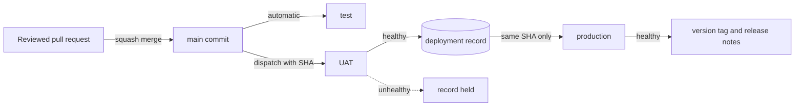
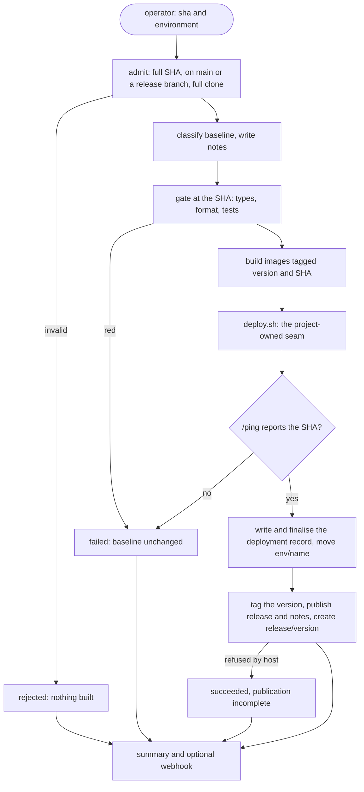
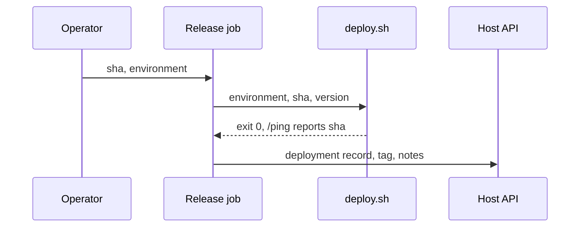
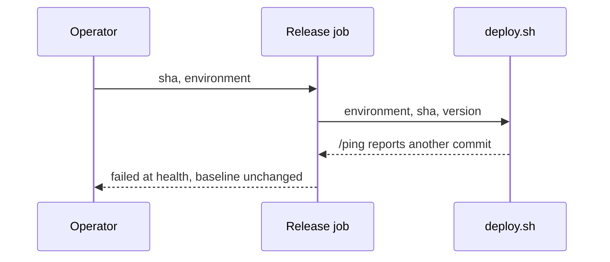
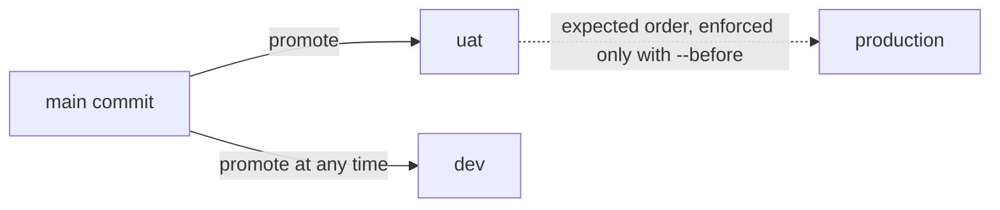

# PRD: trunk-based releases and automated release notes

Status: draft, revised after an independent review. Date: 12-10-2026. Owner: Simon Piscitelli.

Generated apps gain a `--ci github|gitlab|none` choice. It ships a pull request gate, promotion of one validated commit from `main` or a release branch, and release notes written from git history. The same shell scripts run on both hosts; each host adds one pipeline file and one adapter.

## 1. Why

### Problem

- **No pipeline:** a generated app has Dockerfiles and a dev compose file, nothing else.
- **No version:** package versions are static; nothing ties a build to a commit.
- **No release record:** nobody can say which commit is live, or what changed since.
- **Two hosts:** projects land on GitHub and on GitLab; one host's features cannot be assumed.

### Goals

- **Trunk-based:** work merges only to `main`; release branches take hotfixes only (Decision 8).
- **Automated notes:** every release lists what changed since the last healthy release.
- **No manual bump:** the version comes from git history.
- **Same on both hosts:** one operator guide; GitLab adds deploy buttons (Phase 5).
- **No paid services:** no bot account or model key required; branch writes may need a setting or token (Decision 8).

### Non-goals

- **A deploy target:** the starter ships a seam, not Kubernetes, SSH or a cloud.
- **Multi-service releases:** one deployable app, one version.
- **Approval workflows:** paid on both hosts for private repos; documented as opt-in.
- **Automatic rollback:** rollback is re-promotion of an older commit.
- **Releasing the CLI itself:** publishing `create-pimasi-app` stays manual; adopting this process for the CLI is a separate PRD (Simon, 14-10-2026: "this repo is an npm package").
- **Other build targets:** the build stays Docker. A replaceable build, and targets such as Cordova, iOS, Android, Vercel or Firebase, belong to a separate PRD (Simon, 14-10-2026).

## 2. Discovery: how the reference monorepo does it

The reference monorepo promotes one immutable `main` commit by manual dispatch, first to UAT, then the same commit to production. Its release pipeline is about 21,000 lines of GitHub Actions for 14 services. The part that travels to a starter is small: a handful of git and shell steps.



### The core we keep

- **Promote a SHA:** a manual run takes a commit, proves it is on `main`, uses it everywhere.
- **Record after health:** "what is live" moves only once the rollout is confirmed healthy.
- **Notes from the record:** notes cover record to SHA, with wording for redeploy and rollback.
- **Version from history:** the pipeline assigns it from tags; nobody commits a bump.
- **One at a time:** one promotion per environment; rollback re-promotes an older SHA.

### What we adapt

- **State store:** custom git refs written by a bot token become host deployment records.
- **Notes generator:** a GitHub-only model action becomes shell, with an optional model pass.
- **Health proof:** a Kubernetes rollout probe becomes "`/ping` reports the promoted commit".
- **Notifications:** chat cards from a second workflow become a summary and an optional webhook.
- **Version tool:** a .NET calculator, one minor per `main` commit, becomes a date tag, `YYYY-MM-DD.N` (Decision 7).

### What we leave out

- **Per-service records and change detection:** they exist because there are 14 services.
- **The degraded guard and its reset workflow:** they protect a mixed-version fleet.
- **Contract gate and bypass flags:** specific to consumer-driven contract testing.
- **Scheduled dispatcher and convergence gate:** they need a second environment and a cron.
- **Release candidates and infrastructure tags:** tied to a pull-based deployer.

### Lessons carried over

- **Pipeline SHA trap:** a dispatched run's own SHA is the tip of `main`, not the promoted commit.
- **Tags lie:** the newest tag is not the last healthy deploy; keep a separate record.
- **Token limit:** GitHub's default token cannot write a ref at an older commit after workflow edits.
- **Silent green:** a missing webhook secret must not pass for a sent notification.
- **Rules drift:** a rule the pipeline does not enforce gets broken; enforce it or drop it.

## 3. What we build

### Operator experience

| Action    | What the developer does                                                                                      | What they see                                                                  |
| --------- | ------------------------------------------------------------------------------------------------------------ | ------------------------------------------------------------------------------ |
| Merge     | Opens a request titled `fix(api): retry on reset`, squashes                                                  | One `gate` check; on `main`, "waiting for production" and SHA                  |
| Promote   | Clicks ▶ on the commit's pipeline (GitLab), or runs the release pipeline on `main` with `sha`, `environment` | An outcome line, the notes, a `2026-10-12.1` release when the environment tags |
| Roll back | Runs the same pipeline with an older SHA                                                                     | "Rollback to X from Y (N commits removed)"; the old tag returns                |
| Hotfix    | Pushes the fix to `release/2026-10-12.1`, promotes it                                                        | Only that branch ships, tagged `2026-10-12.1.1`                                |
| Check     | Reads `env/<name>` with plain git                                                                            | The commit each environment runs                                               |
| Failure   | Nothing                                                                                                      | A red run naming the failed stage; the baseline is unchanged                   |

This table describes Phase 5, built on 14-10-2026. The hosts differ in three places only.

- **Entry point:** GitHub "Run workflow" or `gh workflow run`; GitLab ▶ on the commit's pipeline, "New pipeline" or `glab ci run`.
- **Summary:** GitHub shows it on the run page; GitLab in the job log and an artefact.
- **Queue:** GitHub keeps one pending promotion per environment; GitLab queues them all. Tagging environments share one lock, so they run one at a time.

### Outcomes

- **`succeeded`:** healthy, recorded, tagged, release published.
- **`succeeded, publication incomplete`:** healthy and recorded; the host refused the tag or release.
- **`failed` at a stage:** nothing recorded; the baseline for the next run is unchanged.
- **`rejected`:** bad SHA, shallow clone or unknown environment; nothing built.

### The release pipeline



A healthy promotion:



An unhealthy one:



### What ships in a generated app

```
Both hosts (templates/ci/common)
release.mk                         make targets: ci, release-test, release-preview, release
docker-compose.ci.yml              server healthcheck, no host ports
docker-compose.release.yml         runs the built production image
RELEASE.md                         operator guide, host checklist, seam contract
scripts/release/config.sh          main branch, release timezone, health timeout
scripts/release/environments/      one file per environment (production.env)
scripts/release/deploy.sh          the seam a project rewrites
scripts/release/*.sh, notes.awk    admit, version, classify, notes, preview, promote,
                                   build, verify, publish, notify, check-title
scripts/release/test/              harness and test files

GitHub adds (templates/ci/github)
.github/workflows/ci.yml           gate on pull requests and main
.github/workflows/release.yml      manual run: sha, environment
scripts/release/host.sh            adapter over the default token

GitLab adds (templates/ci/gitlab)
.gitlab-ci.yml                     gate and release jobs, inputs, resource group
scripts/release/host.sh            adapter over the job token
```

### Scaffolder changes

- **Axis:** `--ci github|gitlab|none`, a select after design; `--yes` gives `none`.
- **Fragments:** `templates/ci/common`, then `ci/<host>`; no `package.json` partial.
- **Manifest:** `ci` in `pimasi.json`; a missing key reads as `none`.
- **Add mode:** `pimasi add ci-github` or `ci-gitlab`; refused when a host is already set.
- **Environments:** `pimasi env add`, `list` and `remove` manage the environment files.

DESIGN.md gains the ninth prompt, the compose step, a LOCKED release contract and a POSIX `sh` convention.

### Environments

Production is the given environment: every project has it, and it tags and publishes by default; from Phase 5, `uat` can too. Every other environment is defined by the project, under any name. Corrected by Simon on 12-10-2026; the first draft shipped one hand-written second environment under a fixed name.

- **Create:** `pimasi env add <name>` writes one environment file from production's.
- **Independent by default:** promote to it at any time, in any order, beside production.
- **Sequential on request:** `--before production` makes production accept only a commit `uat` runs or has moved past.
- **Own state:** each environment keeps its own live record and its own notes baseline.
- **Names:** `uat` for the step before production, expected but not enforced; AstroSiege would add an independent `dev`.

Decided by Simon on 13-10-2026: an environment such as `dev` leaves a live record and no tag. Only the publishing environment tags; from Phase 5, `uat` can be one.

Simon's requirements for environments, stated on 13-10-2026 and built the same day: `env add` and `env remove` now act on the host through `gh` or `glab`, and the release job attaches to the host environment.

- **One step:** `env add` and `env remove` act on the repo and the host together; the name is typed once.
- **Reflected on the host:** each environment has its page on GitHub or GitLab, so configuration is done there, not in code.
- **Storage-agnostic:** secrets may live on the host, in AWS, in 1Password or elsewhere; none is required and none is excluded.
- **Any moment:** a project may supply them at deploy time or fetch them when the application starts, as some regulated entities require; combinations are allowed.

His framing: keep it "extremely lightweight and adaptable", and do not be prescriptive about where configuration lives.

Decided by Simon on 13-10-2026: when `env add` cannot reach the host, it does not fail; "let the first deployment create environment". For that to hold when a first deploy fails, the release job must attach to the host environment at the start of the run, not only write a record after health.



### Existing apps

An app scaffolded with 0.2.0 lacks the base changes the pipeline depends on, and add mode had no step that brings older base files up to date. The CLI now stores the 0.2.0 files it must recognise and upgrades by the rule add mode already had: never overwrite a file the developer changed.

- **Untouched file:** equal to a 0.2.0 snapshot, so it is upgraded in place.
- **Changed file:** the new version is written as `<file>.new` and listed to merge.
- **Formatting tolerated:** a file prettier rewrote on first commit still counts as untouched.
- **Seams too:** adding workers or rate limiting to a 0.2.0 app overwrites cleanly.
- **Safety checks:** dirty-tree refusal and the conflict path apply to `ci` as to any axis.

This departs from the reviewed draft, which wrote `.new` for every prerequisite. Decided by Claude during the build on 12-10-2026, because nearly every real app has had prettier rewrite its files, and the independent review judged the departure sound. Recognising those files is why the CLI gained `prettier` as a third dependency.

### Mechanics

The rules that decide a release:

- **Version:** `YYYY-MM-DD.N`, given at a commit's first deploy to an environment that tags; see decision 7.
- **Live record:** one host deployment record per environment, written after health passes.
- **Baseline:** the newest record finalised as successful and marked `release`; all others are ignored.
- **Notes:** every first-parent commit once, grouped by the type prefix of its subject.
- **Tag and release:** the version itself, after the record; a tag is never moved.

Baseline against SHA, by ancestry, gives one of four modes: range, same, rollback or no baseline. A shallow clone is refused before anything builds, and so is a commit that is neither on `main` nor on a hotfix branch cut from a release (from Phase 5, a release branch's first-parent line above its tag).

A record counts only once finalised. On GitHub the write is two calls, so a record created but never marked successful is ignored. On GitHub the release job attaches to the host environment with `deployment: false`, which writes no automatic record; on GitLab it attaches with `action: start`, which does write one at the pipeline's own commit, and the baseline ignores every record a job created.

Publication is tracked by the release object, not the tag: a version is published once its release exists. Only environments marked to tag create versions and publish; by default that is `production`, and from Phase 5 `uat` can opt in. When the host refuses, the run ends `succeeded, publication incomplete`, and the next promotion of that SHA publishes.

The notes of a version are always those of its first promotion: the range from the record before that SHA's first record in the environment. Repeated retries, a rollback, a tag that already exists and a second environment therefore all give the same notes. On GitHub a refusal happens for a commit older than a workflow edit; an optional `RELEASE_TOKEN` secret with workflow rights avoids it.

The rules around it:

- **Deploy seam:** `deploy.sh <environment> <sha> <version>`; its exit code is the result.
- **Health:** `/ping` must report the SHA within 300 seconds; `/ready` must answer 200.
- **Gate:** `make ci` runs title check, type-check, prettier, then tests in Docker.
- **Lock:** one `release-<environment>` group per host, never cancelled; tagging environments also share one `release` lock, so they run one at a time.
- **Summary:** one Markdown block with outcome, SHA, version and notes; optional `{"text"}` webhook.

The server exposes two probes, as Kubernetes expects. `/ping` is liveness: it checks no dependency, so a database outage cannot make the orchestrator restart every pod, and it reports the commit. `/ready` is readiness: 200 only while the database answers, and Redis when the app has it. The web image is built and pushed but not checked.

What `deploy.sh` does before a project has a target is decision 4. This draft assumes its option A: push both production images, boot the server image on the runner, and say exactly that in the outcome line.

Model-written notes are opt-in, through the Claude API with the key in a masked CI variable. A style-guide file steers a rewrite of the same commit range for a mixed audience. The plain notes are returned instead when the key is missing, the call fails, the reply is empty, or any commit hash is dropped.

## 4. Delivery

### Starter defects found on the way

Proving the design meant generating and running real projects. Five defects surfaced that block the feature and stand on their own.

- **Fixed on 12-10-2026:** `/ping` logged the whole environment, `JWT_SECRET` included, in production.
- **Server image exits:** the `prod` stage of `Dockerfile.server` has no `CMD`.
- **Process count:** pm2 `instances: "max"` started 44 processes on a 22-core machine.
- **Next.js dev container:** exits with `Missing script: "dev"`; the stage has the wrong `WORKDIR`.
- **Formatting:** a fresh scaffold fails `prettier --check .` on 9 to 10 files.

Three smaller ones travel with them. The `file:` workaround in DESIGN.md breaks every Docker build, the lockfile must be committed for `npm ci`, and `git init` does not name the branch `main`.

### Phase 1: base prerequisites

Scope: the four open defects, `/ping` returning version and commit, and version build arguments on the images.

Accept when:

- Four canonical combos pass install, type-check, build, vitest and `prettier --check .`.
- A production server container starts and answers `/ping` with its commit.
- An untouched 0.2.0 project adds a server axis and gets no `.new` generated files.

### Phase 2: axis and gate

Scope: fragments, flag, add mode with the prerequisite check, the pure-git scripts, `make ci`.

Accept when:

- `diff -r` shows add-equals-generate on both hosts.
- Shell tests pass inside a generated app, through `make test`.
- actionlint and GitLab CI Lint accept the pipeline files.
- One pull request and one merge request go green; a title edit re-runs the gate.
- A 0.2.0 project adding `ci` gets the prerequisite list; a dirty tree is refused.

### Phase 3: promotion, live

Scope: promote, build, deploy seam, verify, publish and both adapters, on a throwaway repo per host.

Accept when:

- First release, range, redeploy and rollback each produce the expected notes and record.
- An unhealthy deploy and a failed status write both leave the baseline unchanged.
- Publication retries give the original notes: repeated failures, first release, rollback, tag-only success.
- A migrated 0.2.0 project promotes end to end.
- Every unverified assumption below is settled and its result recorded here.

### Phase 4: optional layers

Scope: model notes, webhook, project-defined environments, `add --refresh`.

Accept the model notes, webhook and refresh when:

- A real model call returns rewritten notes that hold every commit hash.
- A missing key, an HTTP 500 and a dropped hash each return the plain notes.
- A test receiver gets the outcome; a dead URL fails only the strict test.
- A refreshed app equals a fresh scaffold under `diff -r`.

Accept the environments when:

- `pimasi env add uat --before production` writes the file and links production to it.
- A SHA ahead of uat's record is refused; nothing builds and both records stay.
- An accepted promotion updates production's record only, from production's own baseline.
- An independent `dev` promotes in any order and leaves production's record alone.
- Only the publishing environment tags or publishes a release.

### Phase 5: release branches, environment branches and deploy buttons

Decided on 14-10-2026, in Decisions 2 and 8 and the walkthrough recorded under Decision 8. Simon's call for this phase: an Opus agent builds and a fresh Opus agent reviews, with Codex out. Details Simon did not discuss are Claude's spec; the main ones say so. Live runs on a real host do not block this phase; they stay in phase 3.

The flow Simon agreed, step by step: a merge to `main` deploys on-merge environments such as `dev` with no version; the commit's pipeline shows a deploy button per other environment; ▶ uat re-tests, assigns the version, builds, deploys and checks health, then records and moves `env/uat`, then tags, publishes and creates `release/<version>`; ▶ production on the same pipeline reuses the version and moves `env/production`; a hotfix is a commit pushed to the release branch, deployed by the same buttons.

Release branches (Decision 8):

- **Once per version:** only a first-level version `YYYY-MM-DD.N` gets `release/<version>`; a hotfix version `T.P` gets none.
- **Order and retry:** the branch is created only after publication confirms the tag at this commit, and any later deploy of that version creates it when missing. An existing branch is left alone, with a warning only when its first-parent line does not hold the tag; hotfixes that advance it are expected. A refused write ends `succeeded, publication incomplete`, like a refused tag.
- **Hotfix admission, Claude's spec:** a commit is a hotfix of `T` when it sits on `release/T`'s first-parent line strictly above `T`, and `T` is a first-level tag on `main`. A commit that already carries a release tag stays admissible. `notes.sh`, `classify.sh` and `version.sh`, which also ask for a hotfix's base, use the same rule, and hotfix notes read as today.
- **One line per version, Claude's spec:** the hotfixes of one version follow each other on its branch, so `T.2` contains `T.1`. This replaces sibling hotfix branches cut from the same tag.
- **Prefix, Claude's spec:** `RELEASE_BRANCH_PREFIX`, default `release/`, replaces `RELEASE_HOTFIX_PREFIX`, and a `hotfix/` branch loses any meaning. Simon said "release dash"; the slash matches `env/`.

Environment branches (Decision 2):

- **Moved after the record:** `env/<name>` moves to the deployed commit after every healthy deploy. Rollbacks and hotfix lines move it backwards or sideways, so every move is a forced update.
- **Best effort:** a refused write is a warning in a succeeded outcome. The record stays the source of truth for notes.
- **Rights:** both GitHub release jobs need `contents: write`; the non-tagging one has `contents: read` today. On GitHub, branch writes use `RELEASE_TOKEN` when set, as tag writes do. A protected `env/*` must let the CI identity force-push, and on GitLab every CI branch push carries `-o ci.skip`, so it starts no pipeline.
- **Who releases, decided by Simon on 15-10-2026:** only Maintainers push `release/*`, `env/*` and version tags, and only the pipeline moves `env/*`. On GitLab the pipeline pushes as the Maintainer who pressed ▶; on GitHub, as the `RELEASE_TOKEN` identity, an environment secret limited to `main`, which with Maintainers and Admins is the only one the rules exempt.
- **Maintainer-only switch, decided by Simon on 15-10-2026, details Claude's spec:** the scaffold wizard and `add ci-<host>` ask "Only Maintainers can release?", default yes, and write the answer to `config.sh`; a project without the key, such as one refreshed from before, reads it as off. When on, a GitHub promotion refuses before anything builds if `RELEASE_TOKEN` is missing, pointing to the runbook. A runbook in RELEASE.md gives the host settings for both hosts in the web interface, not through `gh` or `glab`.

Tagging and order:

- **UAT creates versions, decided by Simon on 14-10-2026:** `env add` asks, as it already asks "Deploy automatically after a merge to main?". A new question, "Create a version when deployed here?", defaults to no, and `--publish` answers it for `--yes` runs; the docs example becomes `env add uat --publish`. His words: "it asks ... we can add things like auto or manual." ▶ uat then creates `T`, and ▶ production reuses `T`.
- **No forced order:** `--after` stays opt-in, and the docs example drops `--before production`.

GitLab deploy buttons:

- **Mechanism, Claude's spec:** each ▶ job starts a pipeline on `main` with `sha` and `environment` through the trigger API and waits for its result, the way `dispatch-on-merge.sh` waits, so the release always runs main's tooling. A ▶ dispatch is a manual promotion: `on_merge: false`, no gate proof, the full gate, and none of the on-merge skip rules.
- **Where they appear:** on push pipelines of `main` and `release/*` only. Pipelines started by the form, by deploy on merge or by a button run at main's tip and show none.
- **Pipelines:** `workflow:rules` add `release/*` and keep `env/*` out. A release-branch push runs the gate and shows buttons; it deploys no on-merge environment, since those track `main`.
- **Button list:** a child pipeline generated from main's environment files, so `env add` never edits YAML and DESIGN.md's "without a pipeline edit" holds.
- **Runner:** the started pipeline uses the reserved `release` runner, so a waiting button cannot starve it; `gitlab-plan.sh` grants it through its own input, separate from the merge trigger. GitHub keeps the "Run workflow" form.

Contract and docs:

- **DESIGN.md:** amend the LOCKED release contract and its proof list in the same change: the `hotfix/` rule and its branch protection, "`main` is the only long-lived branch", and "promoting to `uat` first assigns nothing".
- **RELEASE.md:** the hotfix section, the environments example, both buttons and forms, and the permissions on each host.
- **Unchanged:** image tags with the environment in the path, the gate at promotion, notes per environment and the Docker-only build. The "confirm on main" line stays as built until Simon decides.
- **Known effects, stated not changed:** tagging environments share one `release` lock, so ▶ uat and ▶ production run one at a time. GitLab keeps versions only in tags, so if uat's tag is refused, production can assign another version.

Accept when, proved locally with pipeline tests and adapter doubles; live checks are listed under "Unverified assumptions":

- A first tagging deploy creates the tag and `release/<version>` at one commit; a later deploy of that version creates neither when both exist, and recreates a missing branch.
- Commits pushed to `release/<version>` deploy as `<version>.1`, then `<version>.2`, with hotfix notes as today; a merged feature commit, and a commit off the branch's first-parent line, are refused before anything builds.
- `env/<name>` names each environment's healthy commit after a deploy, a redeploy and a rollback; a refused write leaves the outcome succeeded with a warning.
- `env add uat --publish` writes `RELEASE_PUBLISH=true`, and without the flag `env add` asks; ▶ uat creates `T`, and ▶ production on the same pipeline reuses `T`.
- On GitLab, a push to `main` or `release/*` shows one button per manual environment, and DESIGN.md and RELEASE.md describe the new contract.

### Build status

- **Built on 12-10-2026:** phases 1, 2 and 4, and the local half of phase 3; reviewed and approved after one fix round.
- **Built on 13-10-2026:** date versions, the hotfix path, deploy on merge, host-reflected environments.
- **Independent review of the 13-10 work:** REQUEST CHANGES three times, with four, then two, then one finding; APPROVE on 14-10-2026 after the third fix round.
- **Phase 5, built by Opus and reviewed by fresh Opus agents (Codex out, Simon's call):** REQUEST CHANGES with three findings, then with one; APPROVE on 15-10-2026 after the second fix round. A third, small round fixed the three observations Simon picked and was approved too, leaving one test gap: nothing pins that `add` stays quiet with `--yes` or on a terminal.
- **Uncommitted:** everything sits on `feature/trunk-based-deployments`.
- **Not published:** the CLI is still 0.2.0; no app sees this until a release.
- **Not yet run:** a live GitHub or GitLab project, a registry push, a real model call.

The 13-10 review found these, all reproduced locally:

- **Deploy on merge fails for MongoDB apps:** the deploy job lacks an image only the gate job builds.
- **Adding a Redis feature to a 0.2.0 app breaks its build:** the readiness file it needs is not brought along.
- **A hotfix can carry content `main` never held:** settled by Simon's decision below; the content rule is removed.
- **A deleted, untagged hotfix branch blocks later hotfixes:** admission needs a commit it does not fetch.

The fix round closed three of the four. Its re-review left two open:

- **Redis feature on a 0.2.0 app:** the build now passes, but a readiness test brought along expects `/ping` fields only a CI add installs, so the suite goes red.
- **A hotfix merged back with a merge commit:** once `main` contains it, the released hotfix can no longer be redeployed or rolled back to.

Decided by Simon on 13-10-2026 ("go with A"): a released hotfix stays promotable after its branch is merged. A commit that carries a release tag, or sits on a hotfix branch, is admitted even when `main` contains it. A second fix round applies this.

The second fix round closed both. Its re-review was REQUEST CHANGES for one side effect of that rule: a hotfix branch vouched for every commit merged below it, so an already-merged feature commit could be released as a hotfix of an older release. A third fix round narrowed the rule, and a fresh reviewer approved it on 14-10-2026.

The rule as built: a hotfix branch vouches only for commits above the nearest release it descends from. One shape is still admitted: a hotfix-named branch that holds `main` work newer than its nearest release, such as one cut from the tip of `main`, can hand a hotfix number to a side commit merged since that release. It cannot happen in a squash-only repo, or when hotfix branches are cut from tags and never merge `main` in. Simon accepted it as built on 14-10-2026: "I would be happy to accept the as is, but I just want to understand it." The cost is one wrong-SHA guard that stays silent in that shape; the gate and health checks still run at the promoted commit. Phase 5's first-parent rule on release branches closes this shape.

Still to settle on a first live run: token rights, the on-merge pipeline keywords on GitLab, and registry pushes.

### Evidence so far

- **Discovery:** nine readers over the reference monorepo, the starter and host documentation.
- **Prototype:** the recommended design ran locally: 178 shell checks in 2 seconds.
- **Promotions:** three healthy runs took 42 to 59 seconds; two unhealthy runs moved nothing.
- **Add mode:** add-equals-generate held on both hosts in a scratch copy of the CLI.
- **Limits:** local Docker, a file-backed adapter, no registry push, no live host.

## 5. Decisions and open risks

Decided 12-10-2026: Simon said "implement the PRD" without picking alternatives, so the build takes the recommended option, listed first, for all six. That reading is Claude's; each decision stays reversible at the cost it states.

### Architecture decisions

#### Decision 1: where the release logic lives

| Option                                     | Cost                                                            | Best for                                | Gives up                                     | Downstream                                              |
| ------------------------------------------ | --------------------------------------------------------------- | --------------------------------------- | -------------------------------------------- | ------------------------------------------------------- |
| A. Shell in the generated app              | About 36 files and 1,140 lines of shell and tests per app       | Apps handed over or patched per project | Types; one-bump upgrades                     | Fixes reach old apps by `add --refresh` or by hand      |
| B. `pimasi release` subcommands in the CLI | Host clients and promotion still to write; first CLI test suite | One maintainer with many apps           | Local patching; proving a change unpublished | The scaffolder becomes production tooling for every app |
| C. Outside tools such as git-cliff         | Six tools, two install routes per host                          | Teams that want changelog templates     | Host parity                                  | Breakage arrives through upgrades nobody here controls  |

Recommended: A. It is the only option whose promotion path ran end to end; the design panel scored it 26, against 24 for B and 16 for C. What is really being chosen is who owns release logic after scaffolding, the app or the scaffolder. Reversible later, at one migration per app.

#### Decision 2: where "what is live" is stored

| Option                              | Cost                                                             | Best for                    | Gives up                       | Downstream                                        |
| ----------------------------------- | ---------------------------------------------------------------- | --------------------------- | ------------------------------ | ------------------------------------------------- |
| A. Host deployment records          | None, if the old-SHA test passes on GitHub                       | Teams without a bot account | Offline `git log record..HEAD` | State shows on each host's environment page       |
| B. A git ref `refs/deploy/<env>`    | GitHub: a token with Workflows write. GitLab: one setting, 18.4+ | Host-neutral state in git   | Zero setup                     | An expired token stops releases                   |
| C. A state file on an orphan branch | No secret; commit noise; untested                                | The fallback if A fails     | A clean history                | Push races when two environments release together |

Recommended: A. Default tokens write deployment records on both hosts, so a new project releases with no secrets. What is really being chosen is host record or git ref as the truth: two adapter verbs, swappable later.

Revisited and decided by Simon on 14-10-2026: the host record stays the truth, and the pipeline also mirrors each environment into git as a branch `env/<name>`, moved after every healthy deploy. His words: "env slash the name is absolutely fine." Anyone can then read an environment's commit with plain git, as in `git log origin/env/production..origin/env/uat`. A failed move is reported and never blocks a deploy; a rollback moves the branch backwards. It uses the same write access as release branches (Decision 8). Built in Phase 5 on 14-10-2026.

Decided by Simon on 15-10-2026: only the pipeline moves `env/*`, and Maintainers are the only people with rights on it. His words: "the env/* branch should be automated only by the pipeline (maintainers as the human work)".

### Behaviour decisions

#### Decision 3: environments

Decided by Simon on 12-10-2026. Production is the given environment; a project defines the others with a CLI command; they are independent unless the project makes them sequential; the environment before production is called `uat`, and it gates production only when a project links them. The reference monorepo's fixed chain of test, UAT and production becomes one general abstraction. The section "Environments" above states the result.

Deploy on merge: decided by Simon on 13-10-2026, option A. His words: "every time we merge into main, then it should auto-deploy to that environment", for a `dev` or `test`. Built on 13-10-2026 as `env add <name> --on-merge`. The options as they were put to him:

| Option                                 | Cost                                           | Best for                           | Gives up                    | Downstream                                  |
| -------------------------------------- | ---------------------------------------------- | ---------------------------------- | --------------------------- | ------------------------------------------- |
| A. Opt-in, `env add <name> --on-merge` | An extra pipeline job; one image set per merge | A `dev` that always tracks `main`  | A smaller pipeline          | Red runs on that environment need an owner  |
| B. Manual promotion only               | None                                           | Projects that promote deliberately | A self-updating environment | Someone runs the promotion after each merge |

Recommended: A, off unless an environment asks for it; the reference's test environment works this way. What is really being chosen is whether merging can deploy anything: one key per environment file, addable later.

#### Decision 4: what "deploy" means before a target exists

| Option                                                       | Cost                                           | Best for                     | Gives up                                         | Downstream                                                           |
| ------------------------------------------------------------ | ---------------------------------------------- | ---------------------------- | ------------------------------------------------ | -------------------------------------------------------------------- |
| A. Push images, boot the server on the runner, check `/ping` | One compose start per promotion                | A starter with no target     | The record means "boots", not "customers run it" | The outcome reads "published and smoke-tested" until a target is set |
| B. Stop at "images pushed"                                   | None                                           | Teams that deploy by hand    | Any health proof                                 | The record means "published"; the health rule is unmet               |
| C. Ship a real target, such as compose over SSH              | A target to maintain; a server and its secrets | Teams hosting on one machine | Host and platform neutrality                     | The starter owns deploy bugs in every generated app                  |

Recommended: A. It proves the artefact on the path a real target will use, and the wording stays honest: "Released to production" appears only once a project replaces `deploy.sh` and sets `RELEASE_HEALTH_URL`. What is really being chosen is what the live record claims on day one. The web image is built and pushed under every option, and health-checked under none.

#### Decision 5: the gate at promotion

| Option                             | Cost                         | Best for                                      | Gives up              | Downstream                                             |
| ---------------------------------- | ---------------------------- | --------------------------------------------- | --------------------- | ------------------------------------------------------ |
| A. Re-run the full gate at the SHA | Gate time on every promotion | Repos where `main` can take unreviewed pushes | The fastest rollback  | A rollback can be blocked by an unrelated failing test |
| B. Trust the merge-time gate       | None at promotion            | Strict branch protection                      | Proof at release time | A red or never-gated `main` commit can be promoted     |

Recommended: A. The reference re-proves the SHA, and its history shows commits reaching `main` without review. What is really being chosen is rollback speed against proof at the moment of release.

#### Decision 6: pull request title format

| Option                                        | Cost                                     | Best for                      | Gives up         | Downstream                                    |
| --------------------------------------------- | ---------------------------------------- | ----------------------------- | ---------------- | --------------------------------------------- |
| A. Enforce `type(scope): summary` in the gate | Eight lines of shell; a bad title blocks | Teams that want grouped notes | Free-form titles | Squash-with-title must be set on the host     |
| B. No rule                                    | None                                     | Teams with ticket-key titles  | Grouping         | Notes read as one flat list under Maintenance |

Recommended: A. The plain notes are built from these subjects. What is really being chosen is grouped notes against friction on every pull request.

#### Decision 7: version scheme

Decided by Simon on 13-10-2026: tags are dates, not a merge count. `YYYY-MM-DD`, a dot and a counter for the release of that day, and a further dot and number for a hotfix, as in `2026-10-12.1.1`. This replaces `<major>.<merge count>.0`. He proposed the scheme and agreed to these rules for it:

- **Format:** `YYYY-MM-DD.N`; the counter is always written, starts at 1, no `v`.
- **One tag per commit, for life:** given at its first production release (from Phase 5, its first tagging deploy), reused by a redeploy or rollback, never moved.
- **Date:** the release day, in a timezone set once in `config.sh`; from Phase 5, the day of the first tagging deploy, often `uat`'s.
- **No tag, no version:** deploys to an environment that does not tag are labelled by their commit.
- **Hotfix:** a third number, for a commit on a branch cut from the released tag.

Updated on 14-10-2026: with `uat` creating versions, a commit gets its version at its first deploy to any environment that tags, not only production, and the hotfix branch is the release branch of Decision 8.

Both were built on 13-10-2026, the date tags first and the hotfix path second. `RELEASE_MAJOR` is gone.

Hotfix content, decided by Simon on 13-10-2026 after the review showed the cherry-pick rule was not enforced: the rule is removed, not tightened. His words: "we just want to create the versioning capabilities to say this is a hotfix and the hotfix comes as a branch from that release, that's all"; whether a commit is a straight pick from `main` or a git-flow style fix is "irrelevant for us", "extremely rare" and "up to that team". The tool names and records a hotfix and takes no view of what is on the branch. Getting the fix back onto `main` is the team's job; the notes of the next release remind them.

What it changes in the built design:

- **Assigned, not computed:** the pipeline reads that day's tags to pick the next counter.
- **Untagged deploys:** an environment that does not tag, such as `dev`, shows the commit, not a version.
- **Hotfix path:** a hotfix number needs a branch from the released tag, so admission now accepts a commit on a hotfix branch as well as on `main`. Phase 5 replaces the hotfix branch with the version's release branch.

OpenClaw was checked as a possible model and matches only in part. It tags `vYYYY.M.PATCH` with dots, because the same string must be a valid npm version. It used the day until May 2026, then moved to a monthly counter. It has no third level for hotfixes, and every release tag since April 2026 sits on a release branch, not on `main`.

#### Decision 8: release branches

Decided by Simon on 14-10-2026: each version gets a release branch, made by the pipeline at the moment the version is tagged, and hotfixes go on it. This replaces cutting a `hotfix/` branch by hand. His words: "it might be best to use the release branch ... because then it's one process for normal release and a hotfix." Built in Phase 5 on 14-10-2026.

Decided by Simon on 15-10-2026, after the Phase 5 review found that a protected `release/*` hands protected GitLab credentials to whatever YAML is pushed there: only Maintainers push `release/*` and do a release. His words: "B. only maintainers can do a release." The option set aside left `release/*` unprotected, so credentials reach only `main`, at the cost of anyone being able to delete a release branch. On GitLab, host protection makes a non-Maintainer's tag and branch writes fail, but on GitLab Free it does not stop the deploy itself. On GitHub, rules that exempt the release automation stop nothing on their own: every workflow runs as that automation, so a write-access user could write those refs from any branch. Found in the Phase 5 fix round, and closed by the enforcement decided next. Starting a release on `main` stays open to anyone with write access on GitHub, unless environment required reviewers stop it; a role check before anything builds is in todo.md.

Decided by Simon on 15-10-2026, after the re-review showed every GitHub workflow runs as the identity the rules exempt: enforce it on GitHub. `RELEASE_TOKEN` becomes a secret on each environment, each environment limited to `main`, and only that token's identity, Maintainers and Admins may write `release/*`, `env/*` and version tags; the default token is never exempt. His words: "Yeah, import it" (speech-to-text for "implement it"). He asked for a runbook to create the token, and for the CLI wizard to ask whether this is mandatory or optional.

How, decided by Simon on 15-10-2026: a runbook plus a wizard switch, and the host settings stay manual. His words: "only A, because I particularly don't like to use the gh or glab CLIs." The option set aside had the CLI apply rulesets, protected branches and secrets through `gh` or `glab`.

| Option                                         | Cost                                                         | Best for                              | Gives up                               | Downstream                                 |
| ---------------------------------------------- | ------------------------------------------------------------ | ------------------------------------- | -------------------------------------- | ------------------------------------------ |
| A. Made when needed, named `release/<version>` | About one build-and-review round                             | Rare hotfixes                         | One manual step: a branch from the tag | No branch per version; no new write access |
| B. Made at every tagged version                | A, plus CI writing branches on both hosts and a cleanup rule | One process for releases and hotfixes | One branch per version                 | CI needs repository write access           |

Recommended was A, because hotfixes are rare; Simon chose B for one process. His reason and his answer on cleanup imply B; he did not name the letter. The costs that come with it, as the options table put them: one branch per version, so one per merge if UAT tags every merge, and repository write access for CI. On GitLab that is the job-token push setting (off by default, generally available in 18.4), which acts with the rights of the person who started the job; on GitHub it is `RELEASE_TOKEN` wherever workflow files differ from `main`'s tip. Release branches are kept, with no cleanup rule, decided by Simon on 14-10-2026: "I don't see any real detrimental build up." Two goals above bend when this is built: `main` stops being the only long-lived branch, and GitHub can need a token beyond the default.

The tool can then read a hotfix's base from the branch name instead of inferring it, so the hotfix shape accepted under "Build status" can be closed. A release branch does not say which environment runs its version; seeing that from git is a separate question, and it reopens Decision 2.

#### Open from the 14-10-2026 walkthrough

Simon described the flow he wants, starting from GitLab. These points differ from what is built; each is marked decided or open, and Phase 5 builds the decided ones:

- **Environment state in git, decided:** an `env/<name>` branch per environment (Decision 2).
- **Brackets and tagging at UAT, decided by Simon on 14-10-2026:** he wants UAT and production brackets, parallel inside one, such as a client sandbox beside `uat`, while dev deploys on merge when switched on, and "deploy UAT manual ... will create the tag and push the version". UAT before production is the expected flow, not a rule: "keep it loose ... I don't want to have a rule in the system to force it to go to UAT first." This matches Decision 3: environments stay independent unless a project opts in with `--after`. What follows, in Claude's reading, which Simon did not contest: a bracket comes down to whether an environment tags (`RELEASE_PUBLISH=true` in `uat.env`), production still tags a commit that arrives without a version, and the docs example `env add uat --before production`, which opts in, becomes `env add uat --publish` (Phase 5).
- **Buttons on each pipeline, decided by Simon on 14-10-2026:** on GitLab, every commit's pipeline shows a deploy button per environment, and on-merge environments deploy without one. He walked the flow (a merge deploys dev without a version, ▶ UAT creates the version, ▶ production on the same pipeline reuses it) and called it "absolutely perfect and in line with what I was expecting". GitHub keeps the "Run workflow" form, because its equivalent, required reviewers, is limited to public repositories on Free, Pro and Team; he left the GitHub side to us: "you'll know best". Asked to confirm the buttons were decided, he answered "That's correct."
- **Image tags, unchanged:** both images keep the environment in the image path. A server image built once per version and reused, and per-service rules for which images need an environment, are proposed for the build PRD; not decided.
- **Build per environment, decided by Simon on 14-10-2026:** front-end values stay baked at build time, because targets go beyond Docker: "think of A, mobile app build, to B, edge deployment", or Vercel, Cloudflare and Firebase. Each deploy keeps building for its own environment, as built. The build stays Docker-only here; a replaceable build is a separate PRD. His words: "The scope of this work is the versioning and management of version and environments."

Smaller: whether to keep the "confirm on main" line in notes, and whether production notes name the versions they cover.

### Unverified assumptions

Each has a cheap test, all in phase 3 on a throwaway repo.

GitHub:

- **Old SHA:** a deployment record is accepted for a commit older than a workflow edit.
- **Free private repos:** deployment records work there.
- **Ordered read:** the default token can list records newest first, with their status.
- **Registry and tag:** the default token pushes two new images and tags the tip.
- **Title edit:** editing a title re-runs the gate with the new title.
- **Branch writes, Phase 5:** with no rules on them, the default token creates and force-moves `release/*` and `env/*`, including after a workflow edit.
- **Maintainer-only, Phase 5:** an environment secret reaches the called promotion workflow; the `main` deployment rule withholds it from other branches; the rulesets refuse the default token and let the token's identity through.

GitLab:

- **Records:** the job token reads and writes deployments with no project settings.
- **Release at an old SHA:** the job token creates the release and its tag.
- **Docker-in-Docker:** bind mounts and `docker exec` work on hosted runners.
- **Title retry:** a retried gate job sees an edited title.
- **CI Lint:** the prototype pipeline file has not been linted by GitLab.
- **Job-token push, Phase 5:** with the setting on, the job token pushes and force-pushes `release/*` and `env/*`, and those pushes start no pipeline.
- **Maintainer-only, Phase 5:** protected `release/*`, `env/*` and version tags refuse those writes for a pipeline started below Maintainer.
- **Buttons, Phase 5:** a generated child pipeline's manual jobs show on the commit's pipeline, and a waiting ▶ job reports the started pipeline's result.
- **Environment page:** whether GitLab shows the job's automatic record, at the pipeline's commit, as the latest deployment instead of the promoted commit.

### Risks

- **GitHub refuses old-SHA records:** fall back to decision 2 option B or C.
- **A second language:** 1,140 lines of shell that `tsc` never checks, under a no-comments rule.
- **Upgrades:** a 0.2.0 file the developer changed still needs a hand merge; later fixes need `add --refresh`.
- **A thin "live":** until `deploy.sh` is replaced, the record means "the image boots".
- **Release refused after a workflow edit:** ends `publication incomplete`; `RELEASE_TOKEN` restores it.
