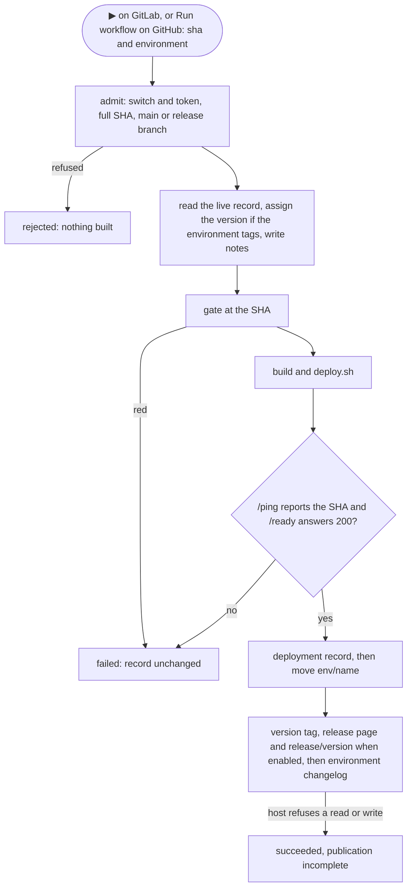

# Releases: a guide for agents

This is the reference for agents changing the release tooling that create-pimasi-app ships into generated apps. Read it before you touch `templates/ci/`, the release parts of `src/`, the "LOCKED release contract" in DESIGN.md or `templates/ci/common/RELEASE.md`. It replaces the plan written between 12 and 15-10-2026, which is in git history at commit `7a107bf` as `docs/20261012135301-prd-trunk-based-releases.md`.

## 1. What it is and where it lives

A generated app chooses `--ci github|gitlab|none`. A host choice ships a pull request gate, promotion of one tested commit to an environment, date versions, release notes written from git history, a release branch per version for hotfixes, and `env/<name>` branches that show what each environment runs. The same POSIX `sh` scripts run on both hosts; each host adds its pipeline files and one adapter, `scripts/release/host.sh`.

Where the truth lives:

- **DESIGN.md, "LOCKED release contract":** the contract. Change it in the same change as the code.
- **`templates/ci/common/RELEASE.md`:** the operator guide every app ships with; it states user-facing behaviour and holds the runbooks.
- **This file:** why the design is the way it is, and what not to undo.
- **`todo.md`:** follow-ups that are neither decided nor built.

```
templates/ci/common/                        both hosts
  release.mk                                make targets: ci, test, release-test, release, release-from-main
  RELEASE.md                                operator guide and runbooks
  scripts/release/config.sh                 main branch, timezone, branch prefix, Maintainer-only switch, health timeout
  scripts/release/environments/*.env        one file per environment; production.env ships
  scripts/release/promote.sh                one promotion, end to end
  scripts/release/admit.sh, hotfix.sh       admission; a hotfix's base read from its release branch
  scripts/release/version.sh                YYYY-MM-DD.N and T.P
  scripts/release/classify.sh, notes.sh     notes from first-parent history (with notes.awk)
  scripts/release/build.sh                  Docker images for one environment
  scripts/release/deploy.sh                 the seam a project replaces; the default calls smoke-deploy.sh
  scripts/release/verify.sh                 /ping and /ready health checks
  scripts/release/publish.sh                tag, release page, release/<version>
  scripts/release/env-page.sh               living changelog release page for every environment
  scripts/release/release-from-main.sh      runs main's tooling for any promoted commit
  scripts/release/test/                     shell suite and host doubles
templates/ci/github/                        ci.yml (gate), release.yml (form), promote.yml, host.sh
templates/ci/gitlab/                        .gitlab-ci.yml, .gitlab/promote.yml, host.sh, gitlab-plan.sh,
                                            dispatch-on-merge.sh, gitlab-buttons.sh, dispatch-button.sh
src/                                        the --ci axis and Maintainer-only question (index.ts),
                                            add ci-<host> (add.ts), pimasi env add|list|remove (env.ts)
templates/legacy/0.2.0/                     snapshots that let apps made with 0.2.0 adopt CI
```

## 2. How a release works



The run:

- **Start:** GitLab shows a ▶ per manual environment on push pipelines of `main` and `release/*`; each starts a manual promotion on `main` through the trigger API and waits for it. GitLab's "New pipeline" form and GitHub's "Run workflow" take `sha` and `environment`. Environments with `RELEASE_ON_MERGE=true` deploy after a merge's gate. Every promotion runs main's tooling.
- **Admission:** a commit on `main`'s first-parent line is a normal release. A commit on `release/T`'s first-parent line strictly above `T` is a hotfix of `T`, and a commit that carries a release tag stays admissible. Anything else, a shallow clone or a bad SHA is refused before anything builds. With the Maintainer-only switch on, a GitHub promotion without `RELEASE_TOKEN` is refused first.
- **Versions:** `YYYY-MM-DD.N`, assigned at a commit's first deploy to an environment with `RELEASE_PUBLISH=true`; production ships with it, and `env add --publish` sets it. Hotfixes get `T.P`. A commit keeps one tag for life, never moved and reused by redeploys and rollbacks; other environments label builds `sha-<first 12 characters>`.
- **Health and records:** `/ping` must report the SHA and `/ready` must answer 200 within `RELEASE_HEALTH_TIMEOUT`. Only then is the host's deployment record written. That record is the truth for what is live and the baseline for the next notes; `env/<name>` mirrors it in git with a forced, best-effort move.
- **Notes:** first-parent commits from the environment's record to the candidate, grouped by the `type(scope):` prefix, in range, same, rollback or no-baseline mode; hotfix notes name their base. A version page keeps its first notes, and the optional model rewrite changes only the summary and webhook.
- **Environment changelogs:** every environment, publishing or not, has one living release page titled `<app> changelog (<environment>)` on fixed tag `changelog/<environment>`, created at the first page write's commit or adopted unchanged if already present without a release, and never moved. After the live record and version publication, inside the environment lock, every range, rollback, no-baseline or hotfix promotion prepends its plain notes under `## <version, or sha-<first 12 characters> when not publishing> · DD-MM-YYYY HH:MM UTC`; a same redeploy adds none. If the new entry alone exceeds 125,000 characters on GitHub or 1,000,000 on GitLab, cut its commit list to fit, ending with `(N more commits not shown)`. Keep the newest 100 entries, then drop the oldest until the body fits the host limit.

Around it:

- **Release branches:** a first-level version gets `release/<version>` once publication confirms its tag. A missing branch is recreated on a later deploy of that version; branches are never deleted, and the hotfixes of one version follow each other on its branch.
- **Outcomes:** `succeeded`; `succeeded, publication incomplete` (healthy and recorded, but the host refused a tag, release page or branch write, or an environment-page read); `failed` at a stage, with nothing recorded; `rejected`, with nothing built.
- **Locks:** one `release-<environment>` lock per environment, never cancelled. Tagging environments also share one `release` lock, so they run one at a time.
- **Images:** `<registry>/<environment>/pimasi-server` and `pimasi-web`, tagged with the commit's first 12 characters and with the version when there is one. Every deploy builds, because the web image bakes in its environment's values.
- **Environments:** production is given; `npx pimasi env add <name>` creates the rest (`--publish`, `--on-merge`, `--after` or `--before`). They are independent unless linked, and `--after X` accepts only a commit that X runs or has moved past. `env add` and `env remove` also create or delete the host's environment through `gh` or `glab` when they can; otherwise the first deploy creates it.

## 3. Rules you must not undo

These rules hold the design together. Change one only with the maintainers' agreement, and add any new settled rule here as behaviour, without names, dates or quotes.

The model:

- **Environments:** production is given, the CLI creates the rest, and they are independent unless a project links them.
- **Deploy on merge:** opt-in per environment; when enabled, every merge into `main` automatically deploys to that environment.
- **No forced order:** uat before production is expected, not enforced.
- **Versions:** a date with a counter, a third number for hotfixes, no `v`; dev deploys get no version.
- **UAT can tag:** `env add` offers version creation independently of automatic or manual deployment, so uat can publish versions.

Branches and hotfixes:

- **Hotfix content:** the team chooses what goes into a hotfix; the tooling provides hotfix versioning and a branch from the base release.
- **A release branch per version:** normal releases and hotfixes share one process; keep release branches without automatic cleanup.
- **Merged hotfixes stay promotable:** merging a hotfix back into `main` does not change its hotfix identity, base or version.
- **Environment branches:** the host record stays the truth and `env/<name>` mirrors it. Only the pipeline moves these branches; maintainers do not push them by hand.

Who releases:

- **Maintainers only:** only Maintainers may release. Both hosts protect `release/*`, `env/*` and version tags.
- **Enforced on GitHub:** `RELEASE_TOKEN` is an environment secret, each environment accepts deployments only from `main`, and only that token, Maintainers and Admins pass the rules; the default token never does.
- **A runbook and a switch:** host settings stay manual, and nothing new may depend on `gh` or `glab`.
- **Buttons on GitLab, the form on GitHub:** keep the GitLab deploy buttons and GitHub release form. GitHub's equivalent approval mechanism, required reviewers, needs a public repository on Free, Pro and Team.

Scope:

- **Docker only, built per environment:** front-end values stay baked at build time. A replaceable build belongs to a separate PRD.
- **This work:** versioning and the management of versions and environments.
- **Elsewhere:** releasing this npm package, versions per service and automatic rollback.

Defaults that are easier to revisit:

- **Release logic:** shell inside each app, not a CLI subcommand or outside tools; fixes reach older apps through `add --refresh`.
- **Host deployment records:** the source of truth, because default tokens can write them without secrets.
- **Default deployment:** before a project replaces `deploy.sh`, a deploy pushes the images, boots the server on the runner and checks `/ping`, and the outcome says exactly that.
- **Promotion gate:** the full gate runs again at promotion, trading rollback speed for proof at release time.
- **Pull request titles:** follow `type(scope): summary`, because the notes group by it.

Environment pages:

- **Version pages:** keep each version's first notes as described in §2.
- **Environment page:** retain one living page per environment, publishing or not, with the fixed title and unmoved or adopted tag described in §2.
- **Entries:** retain the promotion cases in §2; a same redeploy adds none.
- **Entry content:** keep the version or SHA heading, UTC timestamp and plain promotion notes in §2; a model rewrite changes only the summary and webhook.
- **Order and size:** retain the newest-first order, 100-entry limit, host body limits and commit-list truncation with its marker in §2.
- **Timing and failure:** keep page writes after the live record and version publication, inside the environment lock. A refused read or write ends `succeeded, publication incomplete` and never fails the deploy. The summary says the environment page was not updated, names the likely cause (on GitLab, the promotion's user may not create `changelog/*` tags; otherwise a host error), and points to the job artefact `env-page.md` to add the missed entry by hand; a same-SHA retry does not replay it.
- **Protection:** manually protect `changelog/*` tags on both hosts alongside `env/*`, `release/*` and version tags, with creation limited to Maintainers. On GitLab, the job token borrows the rights of whoever started the pipeline; a user who may not create these tags cannot create or update the environment page, and its missed entry does not appear later on its own.

## 4. Working on it

Rules:

- **Contract first:** DESIGN.md and RELEASE.md change in the same change as the code, and `add` must equal `generate` for `ci-github` and `ci-gitlab`.
- **POSIX `sh`:** pass under dash and BusyBox ash, with mawk, gawk and BusyBox awk; JSON goes through `jq`; scripts are mode 644 and run as `sh path`.
- **Templates:** no comments in template code; format for Prettier with `tabWidth: 4`, because the repo's own Prettier ignores `templates/`; keep the tokens the CLI renames (`__APP_SLUG__`, `@pimasi/lib`, `pimasi-server`, `pimasi-web` and the rest).
- **Words:** British English and no em dashes. Environments are `production`, `uat` and `dev`; use only those names in anything that ships.
- **Hands off:** `templates/base/.claude/skills/code-review/references/risk-lenses.md` is hand-written; leave its "staging".

Tests:

- **CLI:** `npm test` builds and runs `test/*.test.ts`.
- **Shell suite:** scaffold an app with `--ci github` or `--ci gitlab` and run `make release-test`; it runs in `docker:29-cli` with BusyBox ash and awk.
- **Full matrix:** run the app's `scripts/release/test/run.sh` in an image with dash, mawk and gawk, switching the shell and awk per run, as below.
- **Static checks:** `shellcheck -s sh -S error`, and actionlint 1.7.12, whose error on `queue` under `concurrency` is known and accepted; Prettier on generated apps.
- **Fail first:** show each new test failing on the old code or on a named mutant. No live credentials exist, so extend the doubles in `scripts/release/test/` (`harness.sh`, `stateful-curl.sh`, `http-stub.sh`).

```Dockerfile
FROM docker:29-cli
RUN apk add --no-cache dash jq tzdata mawk gawk shellcheck make curl git
```

```sh
ln -sf /usr/bin/dash /bin/sh        # or /bin/busybox
ln -sf /usr/bin/mawk /usr/bin/awk   # or /usr/bin/gawk, or /bin/busybox
sh scripts/release/test/run.sh
```

Traps learned from the reference monorepo and from building this:

- **Pipeline SHA:** a dispatched run's own commit is `main`'s tip, not the promoted one; use the `sha` input.
- **Tags lie:** the newest tag is not the last healthy deploy; read the record.
- **GitHub's default token:** it cannot write a ref at an older commit after a workflow edit; `RELEASE_TOKEN` can.
- **Silent green:** a missing webhook secret must not pass for a sent notification.
- **Rules drift:** a rule the pipeline does not enforce gets broken; enforce it or drop it.

Review follows the `code-review` skill, as AGENTS.md says. This work was built by one agent and reviewed by a fresh one in every round, with unreferenced snapshot commits marking each review's boundary.

## 5. Limits and open work

Not yet proven on a live host. RELEASE.md, "Hosted verification still required", lists every check:

- **Overall:** nothing has run on a real GitHub or GitLab project, a registry or a real model call.
- **GitHub:** environment secrets reaching the called workflow, the `main` rule withholding them from other branches, rulesets refusing the default token, and branch writes after a workflow edit.
- **GitLab:** job-token pushes and force pushes with `-o ci.skip`, buttons in a child pipeline, protection refusing writes below Maintainer, the environment page showing the promoted commit, and CI Lint.
- **Environment changelogs:** release reads and creates/updates with each host's release token, fixed `changelog/*` tag creation and protection, and the host body limits remain unverified on live hosts.

Accepted gaps:

- **Who can start a release:** on GitHub, anyone with write access can start Release on `main`; on GitLab Free, a non-Maintainer can still deploy, though the tag and branch writes are refused. Required reviewers, protected environments or a role check would stop it.
- **GitLab environment changelog permissions:** `changelog/*` creation is limited to Maintainers. The job token borrows the rights of whoever started the pipeline, so a promotion started by a user who may not create those tags cannot create or update its environment page. Its missed entry does not appear later on its own; add it by hand from the job artefact `env-page.md`.
- **One queue:** tagging environments run one at a time.
- **GitLab keeps versions only in tags:** if uat's tag is refused, production can assign a different version.
- **A release branch deleted by hand:** the next release's notes lose the "Hotfix was live" reminder.
- **Environment changelog retention:** at most 100 entries, also bounded by 125,000 characters on GitHub or 1,000,000 on GitLab; old entries are dropped, not archived, and an oversized new entry's commit list is cut to fit with `(N more commits not shown)`. The fixed tag identifies its original commit, not what is currently live; a tag left without a release is adopted without moving it on the next promotion with changes.

Open:

- **In `todo.md`:** a role check before deploy, `env remove` leaving `env/<name>` behind, duplicate merge request pipelines on release branches, a release page whose tag is missing, whether missed environment entries should gain a replay path beyond manual recovery, coverage that `add` stays quiet with `--yes` or on a terminal, and whether `env add` and `env remove` keep using `gh` or `glab`.
- **Shell tests in apps:** the suite, about 60 files, ships in every app and runs in `make test` and the gate. Whether it should live only in this repo remains open.
- **Separate PRDs:** a replaceable build (non-Docker targets, per-service images, a server image built once per version) and releasing this npm package.
- **Not published:** the CLI is still 0.2.0, so no app sees any of this until a release.
