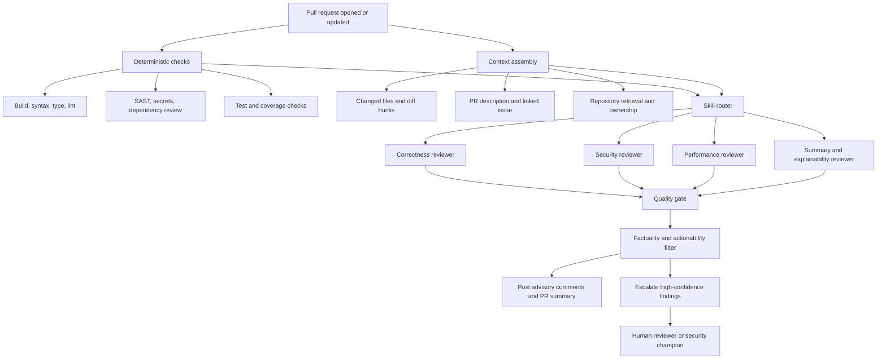
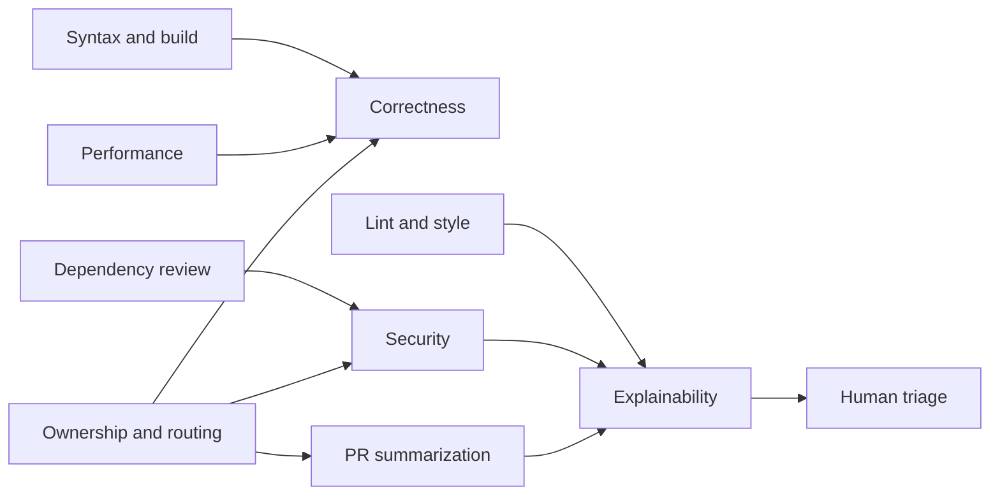
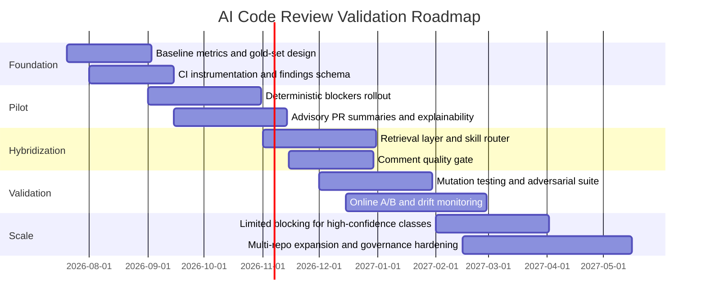

# Building a Validation Workflow for AI Code Review Agents

## Executive Summary

This report assumes no specific programming language, framework, or repository size. The recommended workflow is therefore **language-agnostic by default**, with language-specific analyzers and test harnesses plugged in as needed. The core design principle is to treat AI review as a **layered evidence pipeline**, not as a single model that “reviews code.” In practice, the most reliable systems combine deterministic analyzers, repository-aware retrieval, LLM-based reasoning, executable validation, and human triage rather than relying on free-form generation alone. That direction is strongly supported by current platform capabilities from GitHub and GitLab, by industrial deployments such as Atlassian’s RovoDev and ByteDance’s BitsAI-CR, and by recent repository-level benchmarks such as c-CRAB, AACR-Bench, and CodeFuse-CR-Bench. citeturn25view2turn21view3turn18view0turn30view0turn19view0turn19view1turn19view2

A useful operating model is to separate AI review into **three lanes**. First, a **deterministic blocking lane** for syntax, type, dependency, secret, and high-confidence security findings. Second, a **hybrid advisory lane** for likely correctness, maintainability, and performance issues, where LLM suggestions must be grounded in retrieved code context and validated by tests or static evidence. Third, a **communication lane** for PR summaries, reviewer routing, and explainability. This lane produces value even when detection is imperfect, because summarization and context compression reduce reviewer effort without changing merge policy. GitHub and GitLab already expose the control points needed for this design through required status checks, protected branches, CODEOWNERS, merge request approval policies, SARIF ingestion, code scanning, dependency review, test report widgets, and security dashboards. citeturn20view1turn20view2turn20view3turn21view3turn25view3turn25view2turn20view4turn21view7turn25view1

The most important success metrics should be split by lane rather than collapsed into one score. For the blocking lane, prioritize **precision and false-positive control**, because noisy blocking erodes trust quickly. For the advisory lane, prioritize **recall on meaningful issues** plus **actionability**, because some false positives are tolerable if the comments are easy to dismiss and frequently lead to fixes. For the communication lane, prioritize **factual accuracy**, **coverage of changed areas**, and **time saved per pull request**. Empirical results show why this separation matters: Atlassian reported a **38.7% code resolution rate** for AI-generated review comments versus **44.45%** for human comments, along with a **31% reduction in median PR cycle time** and a **35.6% reduction in human-written comments per PR**; ByteDance reported **75.0% precision** for review comment generation and used an **Outdated Rate** metric to track whether comments were superseded or effectively unhelpful; another industrial study found **73.8% of automated comments were resolved** but a longer average PR closure time, showing that “accepted comments” and “faster workflow” do not always move together. citeturn18view0turn30view0turn18view1

For data, do not build on one benchmark alone. A production-grade program needs at least four dataset families: **review-comment corpora** for comment generation and quality filtering; **bug and repair datasets** for correctness and regression checks; **security corpora** for vulnerability detection; and **repository-level benchmarks** for realistic, cross-file behavior. Public sources now cover all of these: CodeReviewer’s multi-language code-review dataset, large public pull-request comment corpora on GitHub, Defects4J, BugsInPy, ManySStuBs4J, Juliet, OWASP Benchmark, SWE-bench Verified, DevEval, c-CRAB, AACR-Bench, CodeFuse-CR-Bench, HumanEval, EvalPlus, BigCodeBench, CodeSearchNet, and permissively licensed pretraining corpora such as The Stack. The right approach is to use public data for pretraining and offline evaluation, then add carefully governed internal data for fine-tuning, retrieval, and calibration. citeturn13search16turn32view0turn33view8turn33view9turn33view10turn10search3turn33view11turn33view0turn33view1turn19view0turn19view1turn19view2turn35view0turn33view3turn35view1turn33view12turn34view0

The most actionable recommendation is to start with a **hybrid workflow in six phases over six to twelve months**. Begin by instrumenting deterministic checks and collecting a gold evaluation set. Then add AI advisory review for summaries and non-blocking suggestions. Next, introduce a retrieval layer, a comment-quality filter, test-based evaluation, and human feedback loops. Only after measured precision is consistently high should any AI-generated finding be allowed to block merges, and even then only when the finding is backed by deterministic evidence or executable proof. Recent repository-level ACR benchmarks show that current tools still miss a large fraction of issues—c-CRAB reports that existing review agents together solve only about **40%** of tasks—so a human backstop remains necessary for high-stakes correctness and security reviews. citeturn19view0turn25view2turn20view2turn21view3

## Objectives and Success Metrics

The objective of an AI review workflow is not merely to “comment on PRs.” It is to improve merge quality while reducing reviewer load, without increasing merge friction or exposing confidential code. A robust objective stack usually has four layers: **detection quality**, **workflow quality**, **human alignment**, and **business impact**. Detection quality covers whether the agent finds the right issues and avoids noise. Workflow quality covers latency, triage burden, and merge friction. Human alignment measures whether reviewers agree that comments are correct and useful. Business impact covers escaped defects, security incidents, and engineer time saved. This layered framing matches both industrial deployments and platform controls around required checks, alerts, and merge approvals. citeturn18view0turn18view1turn25view2turn20view2turn21view3

A practical metric stack is shown below. The thresholds are **recommended starting thresholds**, not universal standards. They are designed to be conservative because industrial evidence shows that advisory usefulness can be meaningful well below the precision needed for blocking enforcement. citeturn18view0turn30view0turn18view1

| Metric family | What to measure | Recommended starting threshold | Why it matters |
|---|---|---:|---|
| Blocking precision | Precision of blocking findings on labeled benchmark and sampled live PRs | **≥ 0.95** | Blocking noise destroys trust quickly |
| Blocking recall | Recall on critical security/correctness issues with executable or expert labels | **≥ 0.80** before any blocking rollout | Missed severe issues are expensive |
| Advisory precision | Precision of non-blocking comments | **≥ 0.70** at pilot launch, **≥ 0.80** before broad rollout | Advisory tools can tolerate some noise |
| Advisory recall | Recall on known seeded defects and historical incidents | **≥ 0.60** initially, rising over time | Low recall means little reviewer value |
| False positive rate | FP comments per PR | **< 0.25** for advisory, **< 0.05** for blocking | Keeps triage manageable |
| False negative rate | Missed critical issues in seeded/adversarial sets | **< 0.10** for critical classes | Useful for release-readiness decisions |
| Human-AI agreement | Agreement on severity, validity, and actionability | **Cohen’s κ ≥ 0.60** on sampled audits | Ensures the bot is aligned with reviewers |
| Comment actionability | % of comments rated actionable or leading to valid fixes | **≥ 40%** resolved for mature advisory systems | Industrially meaningful even below human performance |
| Time savings | Median reviewer minutes saved per PR; cycle time delta | **10–20% improvement** in pilot; **20%+** at scale | Converts quality into measurable ROI |
| Summarization accuracy | Factual accuracy of PR summaries on audited sample | **≥ 95%**, hallucination rate **< 2%** | Summary errors can mislead reviewers |
| Latency | End-to-end review turnaround per PR | **< 5 min** for deterministic checks, **< 15 min** for AI full pass | Slow tools are bypassed |
| Escaped-defect rate | Post-merge defects or severity-weighted escape rate | Downward trend over quarter | Final outcome measure |

A useful way to operationalize precision and recall is to define the unit of evaluation explicitly. For syntax and type errors, the unit can be a finding. For security, the unit should be a CWE-tagged vulnerability instance. For PR summaries, the unit should be a factual claim. For correctness review, the unit should be an issue category tied to a reproducer or failing test. Recent work argues that text-similarity metrics alone are inadequate for automated code review because two comments can differ in wording while pointing to the same underlying defect; c-CRAB addresses this by converting human review comments into executable tests, and defect-focused ACR work explicitly emphasizes **Key Bug Inclusion** and **False Alarm Rate** rather than BLEU-style matching. citeturn19view0turn14search1turn14search5

Industrial experience suggests adding two operational metrics that are often missed in academic studies. The first is **comment resolution rate** or **code resolution rate**, which proxies whether advice changed the code. Atlassian used this directly and found AI comments were resolved at 38.7%, close enough to human comments to demonstrate practical value, but still below the human baseline. The second is an **outdated or superseded rate**, used by BitsAI-CR, which captures how many comments become obsolete or otherwise fail to survive the author’s next change. Together these metrics are more informative than raw click-through or emoji reactions. citeturn18view0turn30view0

One important caution belongs in the metric design itself: **do not optimize for comment volume**. Industrial deployments show that automated review can reduce human review effort, but they also show that increased comment volume does not automatically shorten PR closure time. An agent should therefore be rewarded for **high-signal compression**: fewer, better comments; accurate summaries; precise code anchors; and clear escalation paths. citeturn18view1turn18view0

## Datasets, Benchmarks, and Labeling Strategy

A strong evaluation program uses a **portfolio** of datasets, because each dataset family measures a different failure mode. Review-comment corpora help with relevance, phrasing, and actionability. Bug-fix datasets help with correctness reasoning and regression discovery. Security corpora help with vulnerability detection and severity calibration. Repository-level benchmarks test cross-file reasoning and environment setup. Execution-based benchmarks stress whether the system can ground its claims in behavior rather than text alone. citeturn13search16turn33view8turn33view9turn10search3turn33view11turn33view0turn33view1turn35view1

### Recommended dataset portfolio

| Dataset or benchmark | Primary use | Strengths | Key limitations |
|---|---|---|---|
| **CodeReviewer dataset** | Pretraining and fine-tuning for code-review tasks | Built specifically for code review; real-world code changes and reviews across nine languages | Historical review comments still contain noise and style variability citeturn13search16 |
| **GitHub Public Pull Request Comments** | Large-scale weak supervision, retrieval corpus, style mining | Over 13 million file-linked PR comments from permissively licensed public projects | Weak labels; language mix; quality inconsistent citeturn32view0 |
| **Modern Code Review dataset** | Reviewer behavior, routing, process analytics | Rich People/Process/Product view across five OSS projects | Older projects and workflows; not optimized for LLM training citeturn32view1 |
| **CodeReviewCommentsNER** | Explainability / entity extraction in comments | Manually labeled entities across GitHub and Gerrit comments | Small compared with generation corpora citeturn32view3 |
| **Defects4J** | Correctness and regression validation | Reproducible real bugs with infrastructure support | JVM-centric citeturn33view8 |
| **BugsInPy** | Correctness validation for Python | Real-world Python bugs with reproducible setup | Python only citeturn33view9 |
| **ManySStuBs4J** | Small-bug detection and repair patterns | Large corpus of single-statement Java bug fixes | Biased toward simple fixes citeturn33view10 |
| **Juliet / SARD** | Security and static-analysis evaluation | Massive synthetic benchmark with known flaws and CWE labels | Synthetic artifacts can inflate unrealistic signals citeturn10search3turn10search11 |
| **OWASP Benchmark** | Security scanner accuracy/coverage/speed | Designed to compare automated vulnerability detection tools | Primarily appsec, not general review quality citeturn33view11 |
| **SWE-bench Verified** | Repository-level issue resolution | Human-validated subset of a widely used real-world benchmark | Measures problem solving more than review phrasing citeturn33view0turn33view2 |
| **DevEval** | Repository-level coding realism | 1,825 samples from 115 repositories, annotated by 13 developers | More coding-agent than review-agent oriented citeturn33view1 |
| **c-CRAB** | Executable evaluation of code review quality | Converts human review feedback into tests; directly evaluates usefulness | New benchmark; current coverage still growing citeturn19view0 |
| **AACR-Bench** | Cross-file, multilingual repository-level ACR | Full repository context, expert-verified annotations, 285% more defect coverage than raw PR comments | New and heavier to run; benchmark complexity is high citeturn19view1 |
| **CodeFuse-CR-Bench** | End-to-end repository-level review generation | 601 high-quality items from 70 Python projects; multi-dimensional evaluation | Python-only today citeturn19view2 |
| **HumanEval / EvalPlus / BigCodeBench** | Behavioral correctness stress testing | Functional correctness, adversarially expanded tests, complex library/tool usage | Not PR-review-native; use as supporting evidence, not sole score citeturn35view0turn33view3turn35view1 |
| **CodeSearchNet / CodeXGLUE / The Stack** | Retrieval, pretraining, code understanding | Large, widely used corpora and benchmarks; permissive licensing focus in The Stack | Not review-specific; governance still required citeturn33view12turn33view7turn34view0 |

### Labeling strategy

The most reliable labeling program has **three layers**. The first is **deterministic silver labels** from static analyzers, dependency scanners, secret scanners, compiler diagnostics, and tests. The second is **expert gold labels** on a carefully sampled subset of pull requests and seeded defects. The third is **behavioral labels** from whether a comment led to a valid fix, was dismissed as noise, or was superseded. Industrial systems increasingly rely on these adoption-oriented labels because they reflect actual reviewer utility better than surface similarity to a reference comment. citeturn25view2turn20view4turn20view5turn18view0turn30view0

For internal data collection, the labeling schema should separate at least five dimensions: **validity**, **severity**, **actionability**, **evidence type**, and **scope**. Validity answers whether the finding is correct. Severity classifies impact. Actionability asks whether the author could reasonably fix it from the comment alone. Evidence type records whether the claim was supported by a compiler error, static-analysis trace, test failure, benchmark delta, dependency metadata, or only a model inference. Scope records whether the issue is local, cross-file, configuration-level, or environmental. This produces more informative training and evaluation data than a single “useful/not useful” label and aligns with research showing that explainable, attribute-level review-comment evaluation is more acceptable than a binary score. citeturn31view0

Label noise is a major risk in review-comment generation. Recent work found that code-review datasets still contain substantial noisy or non-actionable comments, and that LLM-based cleaning can materially improve the downstream quality of review generation. That has two consequences for a production workflow. First, do not fine-tune directly on raw public comments. Second, use a **comment quality filter** before the agent posts anything live, especially for non-deterministic findings. Both RovoDev and BitsAI-CR independently converged on this pattern with factuality and actionability checks or multi-stage filtering. citeturn15search5turn29view1turn30view0

### Synthetic data generation

Synthetic data is most valuable when it is used to **expand hard negatives and edge cases**, not to replace real review data. Good uses include mutated code that should trigger a review finding, adversarial distractors that look suspicious but are correct, dependency manifests with mixed direct and transitive updates, PR descriptions that omit relevant context, and summaries where one changed file is intentionally masked to test omission sensitivity. EvalPlus shows one effective pattern: augment standard coding tasks with automatically generated tests using both LLM-based and mutation-based strategies. The same idea transfers well to code review validation. citeturn33view3turn22view4turn22view5

A recommended data recipe is to keep the training mixture roughly balanced across **human review data**, **seeded defect data**, **security benchmarks**, and **synthetic counterfactuals**. For example, use real PRs for style and explanation, historical incidents for severity calibration, mutation-generated variants for robustness, and benchmark corpora for standardized offline comparison. This avoids overfitting to any single artifact family, especially the synthetic artifacts common in security suites such as Juliet. citeturn10search3turn33view3turn19view1

## Model and Agent Architecture

The architecture question is not “LLM or static analysis?” It is **where each method should sit in the evidence chain**. Deterministic tools are strongest when the failure condition is governed by syntax, types, dependency metadata, secret patterns, or well-defined taint/data-flow rules. LLMs are strongest when the agent must synthesize intent, summarize a PR, reconcile requirements with implementation, or explain why a change is risky in project-specific language. Recent industrial systems are converging on **hybrid** or **multi-stage** pipelines: BitsAI-CR uses a rule-driven detector followed by a precision verifier; RovoDev uses context-aware generation followed by factuality and actionability filters; defect-focused ACR combines static code slicing, multi-role LLM reasoning, and false-alarm reduction. citeturn22view1turn22view2turn22view0turn30view0turn29view0turn28search3turn28search12

### Architecture comparison

| Architecture pattern | Best use | Strengths | Weaknesses | Recommendation |
|---|---|---|---|---|
| **Static-only pipeline** | Syntax, lint, SAST, secret detection, dependency review | High precision, deterministic evidence, easy CI integration | Low semantic coverage; weak on intent and business logic | Use as baseline and blocking lane |
| **LLM-only reviewer** | Summaries, broad advisory review | Flexible, natural explanations, can reason over heterogeneous inputs | Hallucination risk; variable precision; expensive | Avoid as a sole reviewer in production |
| **Retriever + LLM** | Repo-aware advisory review, style, correctness hints | Better grounding and project-specific relevance | Retrieval quality becomes a bottleneck | Recommended for advisory lane |
| **Static + LLM verifier** | Security, correctness, quality triage | Deterministic candidates plus richer explanations | More complex orchestration | Strong default for medium/large teams |
| **Multi-agent specialized skills** | Large repos, complex policies, cross-file reviews | Clear separation of concerns, easier eval by skill | More moving parts and coordination failure modes | Best for mature programs after pilot |
| **Execution-backed review** | Correctness/performance/security claims with tests | Best evidence quality; fewer hallucinations | Higher runtime cost; sandboxing needed | Use for high-severity or sampled validation |

Foundational code models also differ in what they make easy to build. Encoder-oriented models such as **CodeBERT** are useful for classification, ranking, and retrieval. Graph-aware encoders such as **GraphCodeBERT** are helpful when data flow matters. Encoder-decoder families such as **CodeT5** and **CodeT5+** are broader and can unify understanding and generation tasks. **CodeReviewer** is specialized for code-review activities, which makes it attractive for quality gating, comment classification, or smaller in-house review models. citeturn33view5turn33view6turn33view4turn13search1turn13search16

### Recommended skill decomposition

A robust agent should be decomposed into discrete, testable skills rather than optimized as one undifferentiated chatbot. That makes evaluation and rollback much easier.

| Skill | Inputs | Preferred evidence | Typical output | Blocking? |
|---|---|---|---|---|
| **Syntax and build checking** | Diff, compiler/interpreter output, CI logs | Compiler/type checker | Error-localized comments, build status | Yes |
| **Style and linting** | Diff, formatting/lint rules | Linter output | Inline style fixes, autofix suggestions | Usually no |
| **Security scanning** | Full repo or changed files, dependency manifests | SAST, secret scanning, dependency review, DAST where applicable | CWE/CVE-tagged findings, severity, remediation | High-confidence only |
| **Correctness review** | Diff, tests, linked issue, surrounding code | Failing tests, seeded bug sets, symbolic/static traces, executable repro | Risk comments, test suggestions, repro steps | Usually advisory |
| **Performance analysis** | Diff, benchmark harness, profiler outputs | Benchmark deltas, perf tests, traces | “Potential regression” with measured evidence | Only if measurement-backed |
| **Dependency and version review** | Manifest/lock changes, dependency graph | Version metadata, vuln DB, SBOM, change logs | Update recommendations, license/vuln warnings | Yes for known critical vulns |
| **PR summarization** | Title, description, diff, related issue | Repository metadata and changed-file summaries | Accurate change summary, risk areas, reviewer checklist | No |
| **Explainability and citation** | Any model finding | Anchor lines, rule IDs, query traces, test IDs | Why this matters, how to verify, confidence | Required for all AI comments |
| **Reviewer routing and escalation** | Paths, ownership, historical review data | CODEOWNERS, approval policies, historical expertise | Suggested reviewers, escalations | Policy driven |

This agent interaction pattern is a good default:

The interaction between skills should also be explicit, because many real findings are cross-cutting:

### Architecture recommendations

For most organizations, the best first production architecture is a **hybrid retrieval-and-validation pipeline**:

1. **Deterministic pass first.** Run build, lint, tests, dependency review, secret scanning, and SAST.  
2. **Context assembly.** Retrieve changed-file context, linked issue context, ownership, nearby code, and similar historical reviews where available.  
3. **Skill routing.** Send the PR to specialized reviewers instead of one broad prompt.  
4. **Quality gating.** Apply factuality and actionability filters before posting.  
5. **Human escalation.** Route only the highest-confidence items into blocking or mandatory-approval flows.  

This recommendation is directly aligned with the best-performing industrial patterns currently described in the literature and with the platform primitives exposed by GitHub and GitLab. citeturn30view0turn29view0turn28search3turn25view2turn21view3

## Validation, QA, and Human Oversight

Validation should be designed as a **funnel**. Early stages are cheap and broad; late stages are expensive and decisive. A good sequence is: compile/lint/type checks, static security and dependency checks, unit tests, integration tests, mutation tests, adversarial cases, canary sampling, and finally human review of the residual uncertainty. GitHub and GitLab both support much of this flow through required status checks, protected branches, test summaries, code and security dashboards, and merge approval policies. citeturn20view1turn20view2turn21view7turn25view1turn21view3

### Validation checkpoints

| Checkpoint | Purpose | Typical oracle | Failure action |
|---|---|---|---|
| Build / type / syntax | Fast elimination of invalid code | Compiler / interpreter / type checker | Block merge |
| Lint / style / formatting | Enforce conventions and low-risk improvements | Linter / formatter | Advisory or autofix |
| SAST / secret / dependency scan | Catch known security and supply-chain issues | CodeQL, Semgrep, secret scanning, dependency review | Block only at high confidence |
| Unit tests | Verify local behavioral expectations | Existing and generated tests | Block if failing |
| Integration tests | Validate interfaces and environment wiring | Service-level test suite | Block for protected branches |
| Mutation testing | Detect weak or misleading tests | PIT, Stryker | Advisory until mature |
| Adversarial seeded PRs | Stress hallucination and recall | Curated hidden set | Fail the deployment gate |
| Historical incident replay | Check whether the agent would have caught real escapes | Incident reproducer or fault report | Used for release-readiness |
| Canary rollout | Validate live behavior on subset of repos or teams | Online metrics and human feedback | Pause rollout on regression |

Mutation testing deserves special attention because AI review agents often appear strong on superficial issues while missing cases that good tests would expose. PIT describes mutation testing as altering production code and rerunning tests to measure whether tests actually detect those changes, and Stryker explains the same principle across broader ecosystems. EvalPlus extends the same philosophy by generating additional tests with mutation-based and LLM-based strategies to measure functional correctness more rigorously. For an AI review pipeline, mutation score is a valuable secondary oracle for “correctness reviewer” quality, especially when the reviewer suggests new tests or claims a change is safe. citeturn22view4turn22view5turn33view3

### Offline evaluation framework

Offline evaluation should be stratified by skill and by evidence type.

| Offline layer | What to evaluate | Recommended method |
|---|---|---|
| Skill classifiers | Validity, severity, routing, comment quality | Stratified labeled set; precision/recall/F1 |
| Review generation | Comment relevance and actionability | Human rubric plus quality attributes |
| Repository-level review | Cross-file reasoning and latent defects | c-CRAB, AACR-Bench, CodeFuse-CR-Bench |
| Correctness reasoning | Behavioral validity | DevEval, SWE-bench Verified, replayed internal bugs |
| Security detection | CWE/CVE coverage and false alarms | OWASP Benchmark, Juliet, internal vuln corpus |
| Performance claims | Regression detection quality | Hidden benchmark suite with thresholds |
| Robustness | Hallucination resistance and prompt injection resilience | Adversarial PR set |

For the generated-comment layer, use an explainable rubric rather than a single “good/bad” judgment. EvaCRC is useful here because it frames review quality through attributes such as **emotion**, **question**, **evaluation**, and **suggestion**, producing a more nuanced assessment than binary usefulness. That is especially helpful when auditing AI comments for tone, clarity, and actionability. citeturn31view0

### Online evaluation, monitoring, and drift detection

Online evaluation should start with a **shadow mode** or **non-blocking pilot**. Atlassian’s rollout is a good template: internal dogfooding, iterations to stabilize quality, then broader availability while measuring resolution rate, cycle time, and human comment volume. GitHub recommends required status checks and protected branches for enforcement, while GitLab recommends verifying scanners before relying on approval policies so that merges are not blocked by missing or misconfigured scans. citeturn18view0turn20view2turn21view3

A production monitoring dashboard should track at least these trends daily and weekly:

| Monitoring signal | Trigger threshold | Response |
|---|---:|---|
| Blocking precision on audited sample drops | below **0.95** | Disable blocking for that skill |
| Advisory FP comments per PR rises | above **0.25** | Recalibrate thresholds and prompts |
| Human-AI agreement drops | κ below **0.60** | Refresh gold labels and taxonomy |
| Comment resolution rate falls | more than **20%** relative drop | Investigate drift or prompt changes |
| Summary hallucination rate rises | above **2%** | Roll back summary model |
| PR cycle time worsens | more than **10%** over baseline | Reduce comment volume and reroute |
| Security misses in replay suite | any new critical miss | Immediate release freeze for that skill |
| Retrieval health drops | recall@k deterioration on held-out set | Re-index and retrain embeddings |

Continuous monitoring should pull from platform APIs and dashboards where possible. GitHub exposes code scanning webhooks and REST APIs for alerts, and GitLab exposes security dashboards and MR widgets for vulnerabilities and test summaries. Those APIs and dashboards should be mirrored into an internal observability stack so that drift and rollout regressions are detected before reviewer trust collapses. citeturn25view0turn25view2turn25view1turn21view7

### Human-in-the-loop workflow

Human oversight should be structured, not ad hoc. A recommended flow is:

1. **AI posts only evidence-backed advisory comments by default.**  
2. **High-severity findings route to designated humans** using CODEOWNERS or security approvers.  
3. **Reviewers can label each AI comment** as correct, incorrect, duplicate, low-value, or needs escalation.  
4. **Those labels feed a data flywheel** for threshold tuning, retrieval updates, and training-set curation.  

This matches what current industrial systems actually do. RovoDev explicitly posts validated comments back into the review flow where humans can accept, discuss, or ignore them, and BitsAI-CR describes a structured feedback-and-evaluation flywheel. GitHub and GitLab both support ownership and approval routing via CODEOWNERS and protected-branch approval controls. citeturn29view4turn30view0turn20view3turn21view5turn21view3

Reviewer incentives matter. The fastest way to make the system worse is to ask reviewers to “clean up AI mistakes for free.” Instead, make annotation lightweight and rewardable. Good defaults are one-click labels; monthly review of top false-positive sources; dashboards showing time saved by team; and a “human override wins” norm to preserve trust. The system should optimize for reviewer leverage, not reviewer policing. This recommendation is an inference from the industrial evidence that quality and adoption improve when feedback loops are explicit and measured. citeturn18view0turn30view0turn18view1

### Sample validation checklist

Use this checklist for every new skill before broad rollout:

| Checklist item | Pass condition |
|---|---|
| Gold dataset exists | At least **200–500** reviewed examples for the skill, stratified by severity |
| Hidden adversarial set exists | At least **50** seeded or replayed failures not seen in tuning |
| Explanation quality audited | Error messages point to concrete evidence and remediation |
| Live pilot completed | Minimum **2–4 weeks** with shadow or advisory mode |
| Human-AI agreement measured | κ at or above target |
| Precision/recall threshold met | Meets lane-specific threshold table |
| Rollback strategy defined | One configuration change can disable the skill |
| Privacy review completed | No prohibited code/data retention path |
| CI budget measured | Runtime and queueing fit team expectations |

### Sample test cases

| Skill | Sample positive case | Sample hard negative |
|---|---|---|
| Syntax | Missing import or invalid reference in changed file | Generated comment on a file that does not participate in build |
| Lint/style | Formatting regression or forbidden API style rule | Project-specific stylistic exception documented in repo |
| Security | Unsanitized input reaches sink; leaked token; vulnerable direct dependency | Benign string that looks like a secret; tainted path that is actually sanitized |
| Correctness | Off-by-one, null handling, broken condition, missing await, wrong transaction semantics | Large refactor with no behavior change but many moved lines |
| Performance | Added N+1 query, unbounded loop, unnecessary copy, hot-path logging | Micro-optimization suggestion with no measurable regression |
| Dependency/version | New vulnerable package or outdated GitHub Action | Safe transitive update with no reachable vuln |
| PR summarization | Multi-file feature change plus migration and test updates | Summary omits a changed config or states behavior not present in diff |
| Explainability | Comment includes rule ID, evidence, affected lines, next step | Comment is correct but vague: “This may be unsafe” |

## Tooling, Integrations, Governance, and Deployment

The best tooling strategy is to normalize all findings into the **review surface developers already use**. GitHub code scanning accepts SARIF from both CodeQL and third-party tools; GitLab can ingest vulnerability reports and SARIF-compatible scanner results as artifacts for pipeline, dashboard, and project vulnerability views. That means the workflow should not depend on a single vendor. It should depend on a **common event model**: PR opened, diff extracted, checks run, findings normalized, evidence attached, merge policy evaluated, feedback logged. citeturn25view3turn25view2turn21view7turn12search14

### Platform and tool comparison

| Function | GitHub-native path | GitLab-native path | Independent / hybrid options |
|---|---|---|---|
| Review UI | Pull request review, inline comments, viewed files, approvals | Merge request reports, changes view, approvals | PR-Agent, Qodo, vendor bots |
| Branch gating | Protected branches, required reviews, required status checks | Protected branches, merge request approvals, approval policies | Policy engines in CI |
| Static code scanning | CodeQL, third-party SARIF upload | SAST analyzers, SARIF artifacts | Semgrep, Sonar, custom analyzers |
| Dependency review | Dependency graph, dependency review, Dependabot | Dependency scanning, dependency list | Renovate, custom SCA |
| Secret detection | Secret scanning, push protection | Secret detection, secret push protection, validity checks | Custom detectors |
| Dynamic testing | Actions workflows, ZAP Action | DAST reports and security scan widgets | OWASP ZAP, custom DAST |
| Test reporting | Status checks, coverage tools, GitHub Code Quality coverage thresholds | JUnit test summary panel, metrics reports | Any CI with report export |
| Dashboards / APIs | Code scanning API and webhooks | Security dashboard and vulnerability reports | Internal observability |
| Ownership routing | CODEOWNERS | CODEOWNERS | Custom reviewer recommenders |

GitHub’s current platform is particularly strong for a mixed deterministic-and-AI workflow because it combines protected branches, required checks, SARIF interoperability, dependency review, secret scanning, push protection, and a new Code Quality surface that can enforce rulesets and code coverage thresholds. As of **July 16, 2026**, GitHub documents Code Quality as being in public preview with general availability scheduled for **July 20, 2026**. That timing matters if the roadmap depends on it. citeturn20view2turn20view1turn25view3turn20view4turn20view5turn20view6turn20view0

GitLab’s integrated DevSecOps flow is strong when you want merge-request-native security and QA reporting. GitLab surfaces code quality, dependency scanning, DAST, secret detection, test summaries, and security dashboards directly in the merge request and project views. Its approval policies are especially useful for gradual rollout because they let you start with visible scans and later add approval gates once scanner behavior is stable. GitLab’s own documentation explicitly recommends verifying scanners before making approval policies depend on them. citeturn21view4turn21view1turn21view2turn24search0turn24search2turn25view1turn21view3

### Recommended integration stack

For a language-agnostic program, the following stack is a strong default:

| Layer | Recommended default |
|---|---|
| CI orchestrator | Existing GitHub Actions or GitLab CI/CD |
| Deterministic code analysis | Native compiler/type checker + linter + formatter |
| Security static analysis | CodeQL or Semgrep; Sonar optional for broader code-quality rollout |
| Dependency review | Dependabot and dependency graph on GitHub; dependency scanning on GitLab |
| Secret detection | Native secret scanning and push protection if available |
| Dynamic app testing | OWASP ZAP baseline for web apps |
| Test validation | Existing unit/integration runners + mutation testing where feasible |
| PR AI layer | Retrieval-backed advisory reviewer with quality gate |
| Storage | Vector store for repo artifacts and historical reviews; short-lived caches preferred |
| Monitoring | Internal metrics pipeline fed from GitHub/GitLab APIs and webhooks |

Semgrep, CodeQL, SonarQube, PIT, Stryker, and ZAP all fit naturally into this stack. Semgrep can post PR comments; CodeQL treats code as data and is integrated into GitHub code scanning; Sonar positions itself around integrated code quality and security; PIT and Stryker provide mutation-testing backstops; ZAP offers a baseline GitHub Action suitable for non-invasive DAST in CI. citeturn22view0turn22view1turn22view2turn22view3turn22view4turn22view5turn22view6

### Data governance and privacy

Data governance should be designed up front, not retrofitted after the first privacy review. The core rules should be simple:

- **Separate code retrieval from model training.**
- **Default to no retention of proprietary code in third-party training loops.**
- **Keep prompts and outputs auditable and redactable.**
- **Store only what you need for reproducibility and review analytics.**
- **Preserve opt-out and deletion paths for training corpora.**

These principles are consistent with responsible dataset design efforts such as The Stack, which explicitly emphasizes permissive licensing, governance planning, and removal tooling, and with industrial systems such as RovoDev that avoid collecting user-generated content for fine-tuning in order to satisfy privacy and compliance constraints. citeturn34view0turn29view3

For execution environments, runner design is a real security control, not an implementation detail. GitHub documents that GitHub-hosted runners are ephemeral and isolated, while self-hosted runners can be persistently compromised by untrusted workflow code. GitHub also recommends self-hosted runners only for private repositories and provides just-in-time runner support, though it cautions that reusing the underlying hardware still carries exposure risk. Where confidentiality requirements demand self-hosting, prefer isolated runner groups, minimal network reachability, short-lived credentials, and clean-image recreation per job. GitLab likewise documents support for operating its security scanners in offline or otherwise restricted environments. citeturn37view0turn37view1turn21view6

### Deployment and scaling considerations

The main scaling bottlenecks are usually **latency**, **context size**, **queue contention**, and **cost variance across PR sizes**. Recent ACR work shows that context selection quality matters greatly: repository-level benchmarks increasingly emphasize cross-file context, and recent research also shows that more context is not always better because smaller models can collapse when overloaded. That implies three deployment choices. First, use **skill-specific context assembly** instead of dumping the whole repository into every prompt. Second, use **routing** so that simple PRs pay simple costs. Third, keep a deterministic fast path so that common low-risk checks do not wait behind expensive LLM jobs. citeturn19view1turn19view2turn36view0

## Phased Roadmap and Risks

The roadmap below is designed for a six-to-twelve-month program. It assumes a small platform squad plus support from security and developer-experience stakeholders.

### Phase guidance

| Phase | Time box | Core deliverables | Team |
|---|---:|---|---|
| **Foundation** | Month 1–2 | Metric definitions, gold labels, baseline CI integration, findings schema, initial dashboards | 1 platform lead, 1 ML engineer, 1 DevEx engineer |
| **Pilot** | Month 2–4 | Deterministic checks as merge gates, AI PR summary, non-blocking advisory review on a pilot repo set | + security engineer, part-time reviewer champions |
| **Hybridization** | Month 4–6 | Retrieval layer, skill router, factuality/actionability filter, annotation UI, feedback taxonomy | Same core team |
| **Validation** | Month 5–8 | Mutation testing, adversarial hidden suite, incident replay, online A/B tests, drift alerts | + QA/SDET support |
| **Scale** | Month 7–12 | Expanded repo coverage, limited AI blocking for narrow classes, governance hardening, ROI reporting | Platform team + rotating code-owner SMEs |

### Milestones

By the end of the first two months, the program should have a **baseline scorecard**. That includes current review cycle time, current false-positive burden from deterministic tools, a seed dataset of human-labeled PRs, and a hidden regression suite containing historical incidents, seeded secrets, dependency changes, and correctness cases. Without this baseline, later time-savings claims will be too noisy to trust. citeturn18view0turn18view1turn25view2

By the four-month mark, the system should already be delivering value through deterministic gates and high-accuracy PR summaries. GitHub and GitLab make this stage relatively straightforward because both platforms already expose review UIs, checks, approvals, dashboards, and report widgets. This stage should remain **non-blocking for AI-generated advisory comments**; the goal is to gather trust and labels, not to enforce AI opinions prematurely. citeturn12search0turn12search4turn21view4turn24search2

By the six-month mark, the retrieval-backed advisory reviewer and comment-quality gate should be live on a defined pilot set. This is the right time to introduce human-AI agreement measurement, reason-code labeling, and scorecards split by skill. Repository-level benchmarks such as AACR-Bench, CodeFuse-CR-Bench, and c-CRAB should be part of the release gate for any large architecture change. citeturn19view0turn19view1turn19view2

Between months seven and twelve, limited AI blocking can be introduced only for **narrow, evidence-backed classes** such as secrets, known-vulnerable dependencies, deterministic static findings with high historical precision, or correctness findings that are backed by failing tests. Even then, maintain a human override path and an emergency rollback. Current review benchmarks still show large uncovered areas, so a general “AI review required to merge” policy is not yet justified for broad correctness reasoning. citeturn20view6turn38view2turn19view0

### Principal risks and mitigations

| Risk | Why it matters | Mitigation |
|---|---|---|
| **False-positive overload** | Reviewers stop trusting the bot | Quality gate, route by skill, cap comment count, advisory-first rollout |
| **False negatives on severe issues** | Gives a false sense of safety | Hidden replay suite, seeded vulnerabilities, human security approvals |
| **Label noise** | Degrades fine-tuning and calibration | Data cleaning, expert-reviewed gold slices, attribute-rich labels |
| **Context miss or retrieval failure** | Correct code is misjudged or real defects are missed | Per-skill context assembly, retrieval eval, line-anchor validation |
| **Privacy or compliance breach** | Potentially severe legal and commercial exposure | No-train defaults, self-hosted or isolated inference where needed, retention controls |
| **Workflow slowdown** | Engineers bypass or resent the system | Fast deterministic path, latency budgets, comment compression |
| **Vendor lock-in** | Limits control and portability | Normalize via SARIF and platform APIs, keep orchestration internal |
| **Silent drift** | Quality degrades gradually after rollout | Continuous audits, live dashboards, rollback thresholds |

### Final recommendations

The strongest implementation pattern for 2026 is a **hybrid, skill-based review system** that uses deterministic tools for hard evidence, repository-aware retrieval for context, LLMs for reasoning and explanation, and executable validation whenever a claim is strong enough to matter. Recent industrial and benchmark evidence does **not** support handing full merge authority to a general-purpose LLM reviewer. It **does** support using AI to reduce review toil, improve summary quality, increase coverage on hard-to-see issues, and speed feedback when the system is disciplined about evidence, filtering, and human escalation. citeturn18view0turn30view0turn19view0turn19view1turn19view2

If only three decisions are made from this report, they should be these. First, **make deterministic evidence the blocking layer**. Second, **evaluate AI review with executable and behavioral metrics, not text similarity alone**. Third, **treat every agent skill as a separately measurable product surface** with its own threshold, owner, and rollback switch. That combination gives the highest probability of increasing accuracy without turning code review into a new source of operational noise. citeturn25view2turn19view0turn14search1turn30view0turn29view0