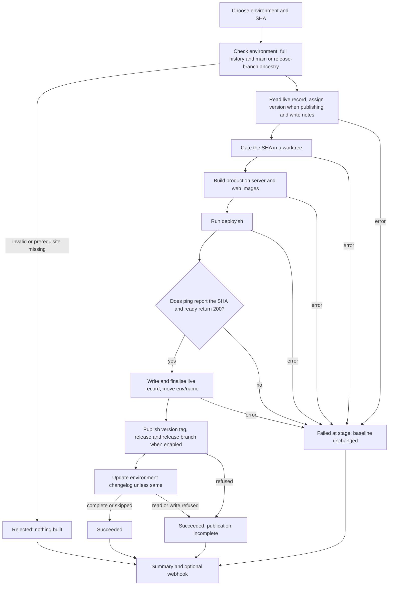
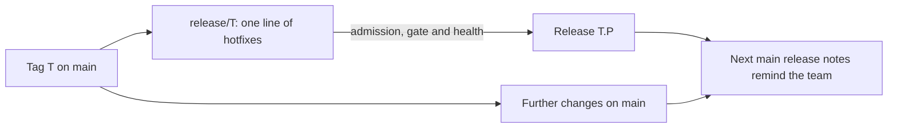
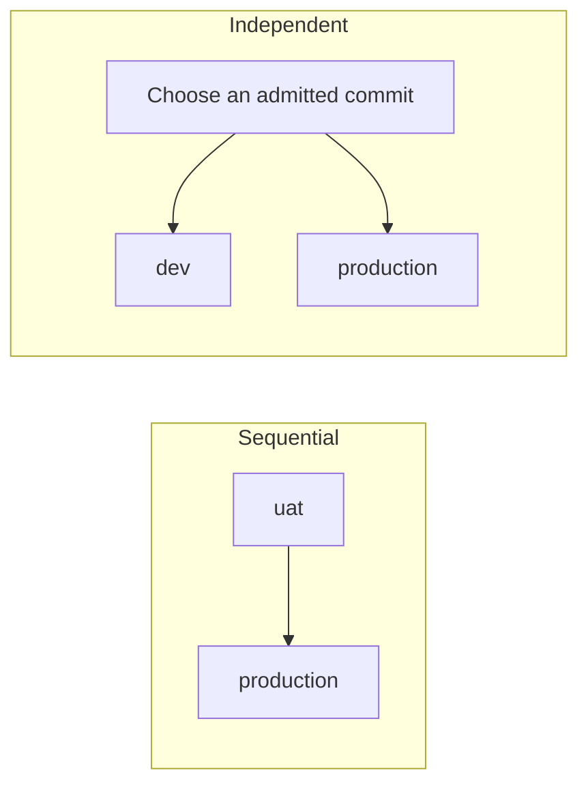
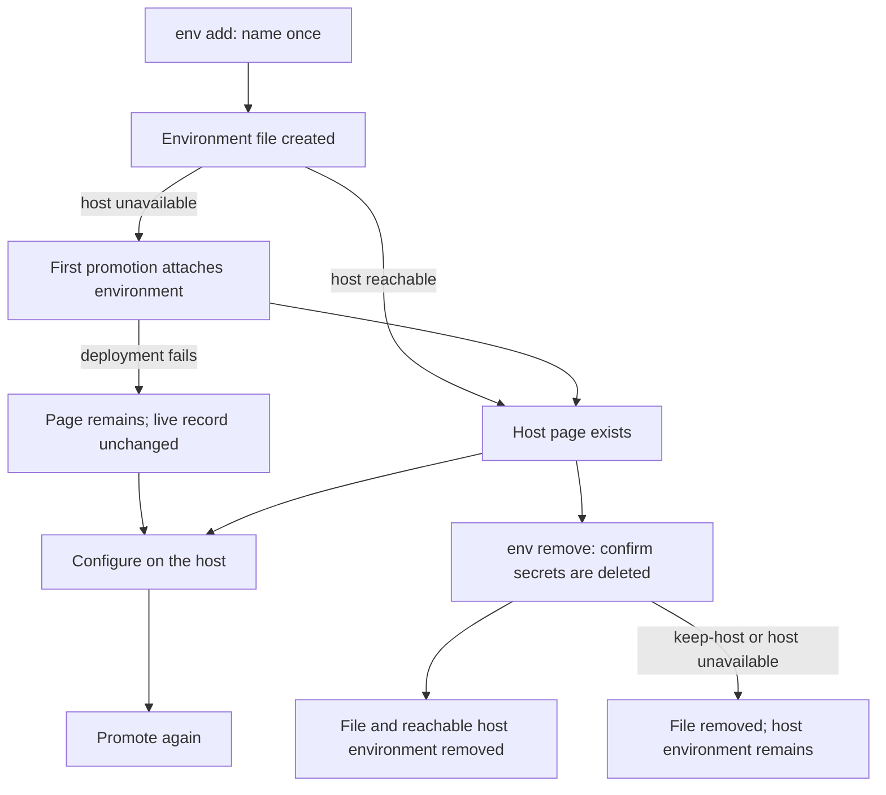

# Releases

## What trunk-based release means here

Merge short-lived branches into `main`, then promote one full commit SHA.
Work merges only to `main`; the pipeline also keeps a `release/<version>` branch for each version and an `env/<name>` branch for each environment.
Normal releases promote a commit on `main`; a hotfix is a commit pushed to its version's release branch, and the team decides what goes on it.
Merging runs the gate and prints the commit and pending notes for each environment.
A person chooses when to promote unless an environment opts into deployment on merge.

The live record is the newest successful release deployment for an environment.
The pipeline writes it only after `/ping` reports the promoted SHA and `/ready` answers HTTP 200.
Until a real target is configured, this record means the production server image passes a smoke check on the runner.
The web image is built and pushed, but never health-checked.

The version and tag are `YYYY-MM-DD.N` for a normal release and `YYYY-MM-DD.N.P` for its hotfixes, with no `v` prefix.
The date is the day the release runs in `RELEASE_TIMEZONE`, set once in `scripts/release/config.sh` and defaulting to `UTC`.
`N` starts at 1 each day, is always written and has no leading zero.
A commit receives its version when first promoted to an environment with `RELEASE_PUBLISH=true` and keeps it for life, including on redeploy and rollback.
Promotions to non-publishing environments such as `dev` assign no version or version tag; their builds are labelled `sha-<first 12 characters of SHA>`.
When `uat` creates versions, its first promotion of a commit assigns the version and a later production promotion of that commit reuses it.
Tags record publication; deployment records tell the pipeline what was last healthy.

For example:

- The first production release on 12 October 2026 is `2026-10-12.1`. A different commit released later that day becomes `2026-10-12.2`.
- Rolling back to the first commit on 13 October reuses `2026-10-12.1`. The next previously unreleased commit becomes `2026-10-13.1`.
- Promoting commit `abcdef1234567890abcdef1234567890abcdef1234` to `dev` labels its build `sha-abcdef123456`. It receives a date version only when promoted to a publishing environment.

Assignment reads remote tags and, where supported, versions in finalised release records across environments.
The next counter is one greater than the highest release counter already used that day.
Dates and counters are compared numerically, so `2026-10-12.10` follows `2026-10-12.9`.
Tags shaped like `2026-10-12.1.1` belong to parent release `2026-10-12.1`; their patch counter does not consume another daily release number.
Unrelated tags, including old `v0.N.0` tags, are ignored and left untouched.



Release scripts come from the tip of `main`.
The gate and Docker builds use a detached worktree at the requested SHA under `.release/src`.
The worktree's HEAD is checked before the gate runs.
Each environment has its own `release-<name>` lock; publishing jobs also share a project-wide `release` queue from version assignment through publication.
This prevents two environments reserving the same counter or assigning two tags to one commit across midnight.
Independent environments still have separate records and no prerequisite unless configured; publishing jobs may wait for another publishing promotion.
Direct callers of `make release` or `promote.sh` must provide the same environment lock and project-wide publishing serialisation for the whole promotion.

## Day to day

### Merge

Title each request `type(scope): summary` or `type: summary`.
Allowed types are `feat`, `fix`, `perf`, `refactor`, `docs`, `test`, `build`, `ci`, `chore` and `revert`.
An optional `!` before the colon marks a breaking change.
Squash with that title after the `gate` check passes.
Leading `Draft:`, `[Draft]`, `(Draft)`, `WIP:` and `[WIP]` markers are ignored case-insensitively; the remaining title must still be valid.

On GitHub, use **Pull requests > your request > Squash and merge**, or:

```sh
gh pr merge --squash --delete-branch
```

On GitLab, use **Code > Merge requests > your request > Squash commits > Merge**, or:

```sh
glab mr merge --squash --remove-source-branch
```

### Promote

Copy the full SHA from the main gate's `Waiting for production` message.
That line names the environment, commit and number of pending changes, followed by the pending notes; it does not predict a version.
Always start the release pipeline on `main`, even when promoting an older commit or a release branch's commit.

On GitLab, the pipeline of every push to `main` or to a `release/*` branch also shows a ▶ (play) button for each environment that does not deploy on merge.
The buttons sit in that pipeline's `buttons` child pipeline, one manual job named `deploy-<name>` per environment, listed from `main`'s environment files.
Press `deploy-uat` to promote that pipeline's commit to `uat`: the job starts the release pipeline on `main` with the commit and environment, waits, and passes or fails with the promotion's result.
GitLab shows a failed button as a warning, not red, because a manual job may fail without failing its pipeline; open the job to read why.
A button keeps waiting through an occasional failed read of the promotion's status; after five in a row it fails, though the promotion may still be running, so check the release pipeline itself.
A button promotion is a manual promotion: it runs the full gate again, takes no gate proof from the push and skips none of the checks of an on-merge promotion.
Pipelines started by the form, by deployment on merge or by a button run at `main`'s tip and show no buttons.

GitLab also keeps the form and the command below, and GitHub uses its form and command only; it has no buttons.
For the current tip, obtain the SHA with:

```sh
git fetch origin main
SHA=$(git rev-parse origin/main)
```

On GitHub, use **Actions > Release > Run workflow**, select branch `main`, and fill in `sha` and `environment`.
The equivalent [GitHub CLI command](https://cli.github.com/manual/gh_workflow_run) is:

```sh
gh workflow run release.yml --ref main -f sha="$SHA" -f environment=production
```

On GitLab, use **Build > Pipelines > New pipeline**, select branch `main`, and fill in the two inputs.
The equivalent command uses a colon between each input name and value:

```sh
glab ci run --branch main --input "sha:$SHA" --input "environment:production"
```

Read the outcome and notes in the job log.
GitHub also appends them to the run summary.
Both hosts retain `.release/outcome.env`, `.release/notes.md`, `.release/summary.md` and `.release/env-page.md` when assembled as job artefacts.

### Roll back

Choose a previously healthy full SHA from the environment's deployment history.
Assign it to `SHA`, then run the same promotion command above with the same environment.
The gate runs again, a publishing promotion reuses the commit's original version, and the notes list removed commits.
Existing version tags never move.

### Hotfix

A hotfix is a commit pushed to the release branch of the version it fixes.
The pipeline creates `release/<version>` at the tagged commit once a publishing promotion confirms the tag of a version `YYYY-MM-DD.N`; if the host refused that write, the next publishing promotion of the version creates it.
The team decides what goes on the branch; the tool names and records it.
Bringing the fix back to `main` is the team's job, and the next normal release's notes remind them to check.

For a release tagged `2026-10-12.1`, switch to its branch:

```sh
git fetch origin
git switch release/2026-10-12.1
```

Make a new fix on that branch and commit it:

```sh
git add path/to/changed-file
git commit -m "fix: correct the released behaviour"
```

Alternatively, cherry-pick an existing fix. Trailers from `-x`, including
`git cherry-pick -x -s`, are readable hints for later notes, never an admission
requirement or proof that the branch contains the same change:

```sh
FIX=abcdef1234567890abcdef1234567890abcdef1234
git cherry-pick -x -s "$FIX"
```

Push the branch:

```sh
git push origin release/2026-10-12.1
```

On GitLab, the push runs the gate and shows the ▶ buttons on that commit's pipeline; press the button of the environment to promote.
Otherwise promote the exact commit with the release pipeline on `main`:

```sh
SHA=$(git rev-parse HEAD)
```

On GitHub:

```sh
gh workflow run release.yml --ref main -f sha="$SHA" -f environment=production
```

On GitLab:

```sh
glab ci run --branch main --input "sha:$SHA" --input "environment:production"
```

A commit is a hotfix of `T` when it sits on `release/T`'s first-parent line strictly above `T`, and `T` is a first-level release tag (`YYYY-MM-DD.N`) whose commit is on `main`.
The branch name, not the nearest tag, names the base.
If a commit sits on the lines of two release branches, the release nearest to it on its own first-parent line is its base.
A commit that carries a hotfix tag `T.P` stays a hotfix of `T` without its branch, so tagged hotfixes remain promotable after the branch is deleted or rewritten.
Commits brought into the release branch by a merge, off its first-parent line, are refused before anything builds; so is a side commit merged into `main`: promote the main commit that contains it.
A commit on `main`'s first-parent chain is always a normal release, including the merge commit that brings a hotfix back.
Branches named `hotfix/` have no meaning.
Only Maintainers push to release branches and run releases; host setup below protects `release/*`, `env/*`, `changelog/*` tags and the version tags for them and says what that protection cannot stop.
The prefix is `RELEASE_BRANCH_PREFIX` in `scripts/release/config.sh` and defaults to `release/`; on GitLab, change the `release/` patterns in `.gitlab-ci.yml` to match.

The hotfixes of one version form one line: push the second fix on top of the first, so `T.2` contains `T.1`.
The first publishing hotfix of T receives `T.1`; the next takes one plus the
highest patch number already used for T in tags and supported recorded
versions. A commit keeps one immutable tag for life, and a hotfix version gets no release branch of its own.
Admission's normal or hotfix decision, and the base it found, are kept for the
whole run: version assignment, notes, publication and retries use them even if the release branch is deleted or rewritten during the run.
A later promotion of a tagged hotfix finds its base through its tag; an untagged hotfix whose branch has gone, or no longer holds it, is refused before anything builds.
Non-publishing environments assign no version. The GitLab record-metadata
limitation below still applies.

The tool takes no view of content or lineage: a rewritten release line, a hotfix of an older release,
and a return to main that omits a fix are allowed.
A hotfix may return to `main` by merge commit, squash or cherry-pick.
After a merge commit, the original hotfix remains promotable with the same
base and T.P version, including redeploy, rollback and promotion from `uat`.
No trailer or patch comparison controls admission.

`RELEASE_AFTER` still requires
an equal or descendant live commit in the prerequisite environment; promote
to `uat` before production when production follows it. Health, finalised
records and publication remain required. The gate and Docker builds run at
the requested hotfix SHA.



Hotfix notes are titled as a hotfix of T and list the branch's commits new
relative to what is live when ancestry allows it. If the live commit is not
an ancestor and this is not a rollback, the notes say `moves <environment> from <what is live> to hotfix
<T.P>` and list the commits since T. This includes moving from a newer release
or a different hotfix line. Redeploy keeps its no-code-changes wording;
rollback lists removed commits, including when rolling back from T.2 to T.1.

The next normal release uses the hotfix's base on main for ancestry and notes.
A short `Hotfix T.P was live` section lists every hotfix commit by subject,
including after a merge commit brings the branch back to `main`.
A hotfix commit that is an ancestor of the candidate, or has a readable
cherry-pick trailer naming an ancestor of the candidate strictly after the
release base, is marked `on main`; otherwise it says `confirm on main`. These labels are
informational and never refuse a promotion. An unversioned hotfix is identified
by its base and SHA. Rollback notes identify hotfix removal.

Admission fetches a missing prerequisite environment's live commit by SHA
before checking ancestry. If the host cannot serve it, admission refuses and
names the unavailable prerequisite commit.
Admission does not require every historical commit to exist in the
clone. A missing destination live commit is fetched by SHA; if the host cannot serve it,
notes explicitly say the baseline is unknown and promotion continues.
Keep release branches: an untagged commit whose release branch was deleted is no longer a hotfix, so it cannot be promoted, and notes treat it as an unrelated live commit with no trusted baseline.

Projects using hotfixes on GitHub should set the optional `RELEASE_TOKEN`
described in host setup. The default token can refuse a tag, release or branch when
the hotfix workflow files differ from main's tip. The healthy record remains
with outcome `succeeded, publication incomplete`; repair permissions and
promote the same SHA again.

### Release and environment branches

The pipeline writes two kinds of branch; nobody creates them by hand.

- **`release/<version>`:** created at the tagged commit once publication confirms the tag, for a first-level version only. A later publishing promotion of that version creates it again when missing. An existing branch is never moved; hotfixes advance it, so the run warns only when its first-parent line does not hold the tag. A refused write ends `succeeded, publication incomplete`, like a refused tag, and promoting the same SHA again retries it.
- **`env/<name>`:** moved to the deployed commit after every healthy deploy, right after the live record is written. Rollbacks and hotfixes move it backwards or sideways, so every move is a forced update. A refused write is a warning in a succeeded outcome; the live record stays the source of truth for notes.

Release branches are kept, with no cleanup rule.
Read the commit each environment runs with plain git:

```sh
git fetch origin
git log --oneline origin/env/production..origin/env/uat
```

On GitLab every branch push from CI carries `-o ci.skip`, so it starts no pipeline, and `workflow:rules` keep `env/*` out as well.
On GitHub, `ci.yml` runs only for pull requests and `main`, so these writes start no gate.

## Outcomes and what to do

- **Succeeded:** read the notes and confirm the reported target matches your intent.
- **Publication incomplete:** repair host permissions, then promote the same SHA again for version publication. For an environment page failure, add the missed entry by hand from the job artefact `env-page.md`; a same redeploy adds no entry, and it does not appear later on its own.
- **Failed:** inspect the named stage, fix its cause, then retry.
- **Rejected:** correct the inputs or fetch full history before retrying.
- **Skipped:** a merge promotion was superseded by a newer main commit or a newer live record. Nothing was built or deployed; the last healthy record remains.

Without `RELEASE_HEALTH_URL`, success reads `Published 2026-10-12.1: images pushed and smoke-tested; no deploy target is configured`.
With a target URL, it reads `Released 2026-10-12.1 to production`.
For a non-publishing promotion, the summary uses the commit label instead of a release version.
Publication failure keeps a successful live record and returns exit code zero.
Gate, build, deploy, health and record failures return a non-zero exit code and leave the baseline unchanged.
An unhealthy or failed run creates no release tag or finalised release record, so it consumes no release counter.

A rejected promotion builds nothing.
A failed deployment can still have changed the real target before health failed.
Inspect that target before deciding whether to retry or roll back.
The pipeline never rolls back automatically.

## Notes and publication retries

Notes compare each environment's own live record with the candidate by ancestry.
They list every first-parent commit once, with its scope, breaking marker and short hash.
`feat`, `fix`, `perf` and reverts become Features, Fixes, Performance and Reverts; everything else becomes Maintenance.
The headings keep that order.
Default GitLab and GitHub merge commits use the request title from the first body paragraph, retaining the merge request or pull request reference as a suffix.
When no title is available, notes use the commit subject.

- **Range:** lists commits added since the live record.
- **Redeploy:** states that the same commit has no code changes.
- **Rollback:** lists removed commits and their count.
- **No baseline:** states that no trusted comparison exists.
- **Hotfix:** names the base release and lists branch commits, grouped by type; readable original main hashes are informational.
- **After a hotfix:** uses its base release for main ancestry, lists the hotfix subjects as a reminder to confirm them on main, and identifies hotfix removal on rollback.

Every environment, publishing or not, has one living release page titled `<app> changelog (<environment>)` on tag `changelog/<environment>`.
That tag is created at the commit of the first page write, or adopted unchanged if it already exists without a release, and never moved; use the live record or `env/<name>` to see what is live.
After the live record and version publication, inside the existing environment lock, a range, rollback, no-baseline or hotfix promotion prepends one entry using that promotion's plain notes.
A same redeploy adds none, including a redeploy of a hotfix.
Each entry starts `## <version> · DD-MM-YYYY HH:MM UTC`; an environment that does not publish uses `sha-<first 12 characters>` instead of the version, even when another environment has versioned that commit.
Entries are newest first. If the new entry alone exceeds 125,000 characters on GitHub or 1,000,000 on GitLab, its commit list is cut to fit, ending with `(N more commits not shown)`. The body keeps the newest 100 entries, then drops the oldest until it fits the host limit.
A refused page read or write ends `succeeded, publication incomplete` without failing the deploy or changing its healthy record.
The record already advanced, so a same-SHA retry cannot replay the missed entry, and it does not appear later on its own.
The summary says the environment page was not updated and names the likely cause: on GitLab, the promotion's user may not create `changelog/*` tags; otherwise a host error.
The plain notes are retained as `.release/notes-plain.md`; the job artefact `.release/env-page.md` keeps the entry to add by hand when the page cannot be updated.

Only an environment with `RELEASE_PUBLISH=true` creates version tags, version release objects and release branches.
Production enables it by default.
A version counts as published only when its release object exists.
A matching tag is reused; a tag at another commit is refused and never moved.
If two publishing environments choose the same new tag, the losing promotion reads remote state again and retries once with the next available version.
That retry regenerates notes against the original destination baseline, rebuilds and redeploys both images, repeats health checks and finalises the new record before publication, keeping the notes, `/ping` and the record aligned with the new version.
A second collision leaves publication incomplete with a clear error; existing tags remain untouched.
If the retry fails before recording, the run reports that failure and attempted version, and explains that the earlier attempt already finalised a record.

To retry publication, promote the same SHA to the same environment again.
The gate, deployment and health check run again before publication.
On GitHub, published notes use the record before that version's first successful release record, in the environment that recorded it first.
Repeated failures, existing tags, intervening promotions and rollbacks do not change that original range.

GitHub stores the assigned version in the deployment description and payload before finalising the record.
If publication is incomplete, a later promotion of that commit reuses the recorded version and a different commit takes the next daily counter.
GitLab's [deployment creation API](https://docs.gitlab.com/api/deployments/#create-a-deployment) has no description or payload field in which to store the version, so GitLab assignment uses remote tags only.
If GitLab refuses publication before creating the tag, the live image still reports the assigned version, but a later commit can reuse that counter and a retry on another day can receive a different version.
Once the tag exists, GitLab reuses it even if the release object still needs publication.
GitLab also cannot recover the version's first publishing environment from deployment metadata, so an unpublished version promoted through a different publishing environment uses that environment's original notes range.
An existing version release object keeps its first notes unchanged on both hosts.

Version release objects and environment changelog entries use deterministic plain notes.
The optional model rewrite affects the promotion summary and webhook.
It never changes version pages or environment changelog entries.

## The deploy seam

Replace `scripts/release/deploy.sh` to connect your infrastructure.
The pipeline calls `sh scripts/release/deploy.sh <environment> <sha> <version>`.
`RELEASE_IMAGE_SERVER` and `RELEASE_IMAGE_WEB` contain the built image references.
For a publishing promotion, `RELEASE_IMAGE_SERVER_VERSION` and `RELEASE_IMAGE_WEB_VERSION` contain the additional version tags; the default seam pushes all four references.
Exit zero when the rollout command succeeds; any other exit code fails the deploy stage.

On GitHub, repository and environment secrets and variables reach the promotion step as JSON through `RELEASE_DEPLOY_SECRETS_JSON` and `RELEASE_DEPLOY_VARS_JSON`, evaluated after the job attaches to its environment.
Only the promotion step receives those JSON contexts; checkout, startup diagnostics and artefact upload do not.
Each serialised context is limited to 120 KiB (122880 UTF-8 bytes), including JSON keys, escaping and whitespace, and is checked before the release runs.
Linux rejects one environment string around 128 KiB before starting the shell; a separate diagnostic reports a failed launch and the limit without receiving either payload.
The diagnostic does not claim to measure a payload when the shell could not start.
The workflow retains environment transport because the [GitHub runner prints interpolated run scripts](https://github.com/actions/runner/blob/main/src/Runner.Worker/Handlers/ScriptHandler.cs), so putting the JSON in a script heredoc would print it.
For larger configuration, keep only the manager credentials or references on the host and fetch the values inside `deploy.sh`, or let the application fetch them at startup.
GitLab supplies individual CI/CD variables and has no combined JSON limit.
The deployment wrapper exports valid environment variable names only for `deploy.sh`, with secrets taking precedence over variables, without printing their values.
The gate runs with an allowlist of operational environment variables and receives neither deployment JSON payload nor inherited deployment credentials; adding deploy credentials needs no workflow edit and survives refresh.
On GitLab, project CI/CD variables reach the job and `deploy.sh`; variables scoped to the selected environment take precedence over the same project key with scope `*`. Configure credentials as masked, protected variables. GitLab passes protected variables to every pipeline on a protected branch, which means pipelines on `main` and on `release/*`, branches only Maintainers can push to. GitLab supplies project-wide variables to its runner automatically; the clean gate command removes inherited credentials before invoking build checks and tests.

The default seam calls `scripts/release/smoke-deploy.sh`, which logs into the host registry, pushes both images, builds release-stack services with a build section except the release-built server and web, then starts the production server on the runner.
Both manual and merge promotions build those dependencies, including MongoDB, even on a fresh Docker daemon.
Image repository paths include the environment because the web API URL is baked into its image.
Both images use the tag `<first 12 characters of SHA>` for every promotion.
A publishing promotion additionally tags the same images with the release version, such as `2026-10-12.1`.
The `APP_VERSION` build argument is that version when publishing, or `sha-<first 12 characters of SHA>` otherwise; `GIT_SHA` remains the full commit.
The server's `/ping` response reports those strings, and its development defaults remain unchanged.
Repository names are lower-cased for Docker.

Set `RELEASE_HEALTH_URL` in the environment file to the real API base URL, without `/ping` or `/ready`.
Within one 300-second timeout, the health check requires `<base URL>/ping` to report the full SHA and then `<base URL>/ready` to answer HTTP 200.
Readiness checks the database and Redis when selected; its failure is reported at the health stage and leaves the live record unchanged.
An empty URL runs both probes inside the production server container.
Change `RELEASE_HEALTH_TIMEOUT` in `config.sh` when your target needs longer.
Setting the URL alone does not deploy anywhere: replace the seam too.

`docker-compose.release.yml` removes the development command, build and mounts so the server image's production CMD runs.
It sets `PM2_INSTANCES=1` for the runner smoke check.
`compose.sh` selects web, database and Redis overrides from the services already present, resetting every service's ports.
Gate and promotion cleanup tear down their runner stacks with volumes on both success and failure.

## Where configuration lives

Configuration can come from the host, AWS, 1Password, a vault or another manager, in any combination.
The starter requires none of them.
Choose when each value is needed:

| Moment            | Values and source                                                                                                                                      |
| ----------------- | ------------------------------------------------------------------------------------------------------------------------------------------------------ |
| Build             | Public web settings in the environment file, such as `VITE_API_URL` or `NEXT_PUBLIC_API_URL`. The browser bundle exposes them; never put secrets here. |
| Deploy            | Whatever the target needs, supplied through the host's environment configuration or fetched by `deploy.sh` from a manager.                             |
| Application start | The application or platform fetches its own secrets using its runtime identity. The pipeline need not receive those secrets.                           |

For example, create `DEPLOY_REGION=eu-west-2` on the host for `dev`.
On GitHub use **Settings > Environments > dev**; on GitLab use **Settings > CI/CD > Variables**, with environment scope `dev`.
The deployment seam can read `$DEPLOY_REGION` without a pipeline edit.
An environment-scoped value takes precedence over the repository or project value with the same name; on GitHub, secrets take precedence over ordinary variables.
The release tooling does not print their values.

A deployment that reads 1Password can install and authenticate its CLI through the project's runner or deployment tooling, then use [a secret reference](https://www.1password.dev/cli/reference/commands/read) inside `deploy.sh`:

```sh
DATABASE_URL=$(op read "$DATABASE_URL_REFERENCE")
export DATABASE_URL
sh infra/rollout.sh "$1" "$2" "$3"
```

Here `DATABASE_URL_REFERENCE` identifies a field such as `op://application/database/url`; the secret stays out of the committed environment file.
The same seam can call an AWS client or another manager.

For a keyless cloud login, configure the provider to trust the repository, branch and environment claims of the host's identity token.
GitHub release jobs grant `id-token: write`; `deploy.sh` can request a token using `ACTIONS_ID_TOKEN_REQUEST_URL` and `ACTIONS_ID_TOKEN_REQUEST_TOKEN`, then exchange it for the provider's short-lived credentials.
The provider's audience, role and exchange command belong in the project's deployment tooling, so adding this login does not require a workflow edit.
GitLab release jobs expose `RELEASE_ID_TOKEN`; set the project variable `RELEASE_ID_TOKEN_AUDIENCE` to the provider's audience, or leave its default of `$CI_SERVER_URL`.
The deployment seam exchanges that token for credentials using the provider's client or API.
See [GitHub's OIDC instructions](https://docs.github.com/en/actions/how-tos/secure-your-work/security-harden-deployments/oidc-in-cloud-providers) and [GitLab's ID token equivalent](https://docs.gitlab.com/ci/secrets/id_token_authentication/).

For an application that reads a vault at start, give the deployed workload an identity allowed to read its database credential, and have its startup code fetch that credential before opening the database connection.
The pipeline deploys the image and checks the live API; it receives no vault credential or application secret.
Host deployment variables and secrets fetched at application start can coexist.

Out of the box, release health checks boot the server image on the runner.
An application that must reach its vault at start may be unable to boot there.
Such a project connects its real target in `deploy.sh` and sets `RELEASE_HEALTH_URL` to that environment's API, so the probes check the deployed application.

## Project environments

Production is given: every project with CI starts with only `production.env`, and it cannot be removed through the CLI.
Create other environments for the project's needs with `npx pimasi env add`.
Each environment is a trusted shell file under `scripts/release/environments/`; these files are the source of truth, with no environment list in `pimasi.json`.
The CLI reads literal assignments without running shell code and preserves unknown quoted multiline values.
Keep the managed release settings as single-line literals; unsupported shell statements are refused before writing.
If environment files change while a prompt is open, the command refuses so it cannot discard those edits.
Names use lower-case letters, digits and dashes, start with a letter or digit, and have at most 32 characters.
The conventional name for an acceptance environment is `uat`; an independent development target can be `dev`.

Environments are independent by default, so they can promote different commits in either order.
Each keeps its own live record and takes notes from its own previous record.
Promoting one leaves every other environment's record unchanged.
A project opts into sequential promotion with `--before` or `--after`.



### Create and inspect environments

Run these commands from the project root:

```sh
npx pimasi env list
npx pimasi env add uat --publish --yes
```

The list shows each name, whether it is the given environment, whether it publishes or deploys on merge, its prerequisite or `independent`, whether a health URL is set, and host status: `exists`, `not yet created` or `unknown`.
The add command copies the project's `production.env` into `uat.env`, sets `RELEASE_PUBLISH=true` because of `--publish`, clears `RELEASE_HEALTH_URL`, and leaves the other build values as placeholders to edit.
Production's file is unchanged: UAT before production is the expected flow, not a rule.
The first promotion of a commit to UAT assigns its version, tags it and creates its release branch; promoting the same commit to production reuses that version.
Production still tags a commit that reaches it without a version.
Without `--publish`, a new environment assigns no versions; on a terminal without `--yes`, add asks "Create a version when deployed here?", defaulting to no.

Two effects of tagging in more than one environment are known and accepted:

- **One at a time:** tagging environments share the project-wide `release` lock, so a UAT and a production promotion that both tag run one after the other.
- **GitLab keeps versions only in tags:** if UAT's tag is refused, a later production promotion of that commit assigns its version again from the tags and can choose another one.

To make production accept only what UAT runs, link them when adding UAT:

```sh
npx pimasi env add uat --publish --before production --yes
```

This also adds `RELEASE_AFTER=uat` to `production.env`.
Production then accepts only a SHA equal to, or an ancestor of, UAT's live record.
If UAT has no trusted record, production refuses before building.
Promote to UAT first using the normal promotion command with `environment=uat` on GitHub or `environment:uat` on GitLab, then promote to production.
Both promotions still use their own notes baselines.

For an independent target, run:

```sh
npx pimasi env add dev --on-merge --yes
```

The new `dev.env` has `RELEASE_ON_MERGE=true` and no `RELEASE_AFTER`, and production's file is unchanged.
Promote to dev with `environment=dev` on GitHub or `environment:dev` on GitLab whenever it is useful, regardless of production's live SHA.
Edit the copied build values and health URL for each new target, then connect it in `scripts/release/deploy.sh` and commit the files on `main` before dispatching a release.
The CLI prints the affected files and the exact promotion command for the project's host.
The main gate prints a preview for every environment file; adding a name needs no pipeline change.

`--after X` makes the new environment follow X.
`--before Y` makes Y follow the new environment; if Y already follows Z, the new environment follows Z and is inserted between them.
For example, after linking UAT before production as above, `npx pimasi env add qa --before production --yes` produces the order `uat`, `qa`, `production`.
Unknown relation targets, duplicate names and cycles are refused.
Without a name, or without `--yes` on a terminal, add prompts for a name, relation, whether to deploy on merge and whether to create versions; `--yes` never prompts and requires a name.

The same command uses an installed, signed-in `gh` or `glab` to create the host environment, using the validated name verbatim and the project's `origin` remote.
An existing host environment is reused.
If the tool, sign-in, remote or permissions are unavailable, the command prints one line and succeeds; the first promotion creates the host page when its job attaches to that environment.
The page therefore remains available even if that first deployment fails before writing a healthy release record.
Configure its variables, secrets and protection rules on the host, then promote again.
With Maintainer-only releases on GitHub, that includes `RELEASE_TOKEN` and the `main` deployment rule; the command prints a reminder of both.



### Deploy on merge

`npx pimasi env add dev --on-merge --yes` opts dev into deployment after a push to `main` passes the gate.
Setting `RELEASE_ON_MERGE=true` directly in any environment file has the same effect, including production.
The pipelines discover the files; no fixed list of environment names is required.
The new environment remains independent unless `--before` or `--after` links it.

Each opted-in environment promotes that pipeline's commit under its own lock.
Promotion skips a second gate only when the candidate and gated SHA match and both non-empty pipeline identities match.
On GitHub, the reusable workflow receives these values through the same run's successful gate dependency and runner context.
On GitLab, preparation reads the claimed upstream pipeline and checks its ID, project, SHA, main ref, push source and running or successful status before passing the proof.
The pipeline API cannot prove the trigger relationship or that the gate completed while that upstream job is waiting for deployment; access to dispatch inputs and release jobs remains part of the trust boundary.
An unreadable or mismatched upstream identity clears the proof and runs the full gate; manual promotions always run the full gate.
Admission, prerequisites, deployment, health checks and publication rules remain in force.
Notes always start from the destination's own live record.
Only `RELEASE_PUBLISH=true` creates a version tag and version release; every environment has its own changelog release page.
A prerequisite is an admission check: linking environments does not waive the requirement that the prerequisite already has an accepted record.

Newer main commits supersede waiting merge promotions.
After acquiring the lock, promotion fetches main and skips an older candidate; it also skips a candidate older than the destination's live record.
An active promotion is allowed to finish, and a late older run cannot move the environment backwards.
If the newest commit's gate fails, the previous healthy record remains until a later gate passes or a person promotes manually.
Manual rollback remains available.

GitHub uses `queue: max` on the environment lock and the shared publishing lock, with active cancellation disabled.
Retaining pending jobs prevents a slower old gate replacing a newer commit that is already waiting; the script skips superseded commits when their jobs start.
GitHub currently limits each queue to 100 pending jobs.
See [workflow concurrency](https://docs.github.com/en/actions/how-tos/write-workflows/choose-when-workflows-run/control-workflow-concurrency).
The no-target case skips both deployment matrices, so no promotion job runs.

A failed merge deployment leaves that environment's healthy record unchanged and makes the pipeline red.
Inspect its failed stage, repair the target or configuration, and let the next merge try again or promote manually.
The failure does not hold its lock or block the next merge's attempt, and another environment's failure does not cancel its peers.
Read the recorded outcome as well as the pipeline status: an orchestration or artefact-upload failure after a healthy promotion can also make a run red.

### Environment keys

Put public build values in the files; keep secrets in the host or a manager as described above.

- `RELEASE_PUBLISH`: only `true` enables version tags, version release objects and release branches after a healthy promotion; environment changelog pages apply to every environment. Production enables it by default; environments added by the CLI disable it unless added with `--publish` or a yes to the version question.
- `RELEASE_ON_MERGE`: only `true` opts into promotion after the main push gate passes. It is absent from fresh scaffolds; any environment can set it by hand.
- `RELEASE_HEALTH_URL`: the API base URL without `/ping` or `/ready`. Empty uses the runner smoke check; a real target also needs the deploy seam connected.
- `RELEASE_AFTER`: an optional prerequisite environment. The candidate SHA must equal or be an ancestor of its finalised live record. Empty or absent means independent.
- `VITE_API_URL` and `NEXT_PUBLIC_API_URL`: public API URLs baked into the TanStack and Next.js web images respectively.
- `NEXT_PUBLIC_PUBLIC_WEB_URL`: the public Next.js web URL baked into its image.
- `VITE_FIREBASE_API_KEY`, `VITE_FIREBASE_AUTH_DOMAIN`, `VITE_FIREBASE_PROJECT_ID` and `VITE_FIREBASE_APP_ID`: public Firebase build values for TanStack.
- `NEXT_PUBLIC_FIREBASE_API_KEY`, `NEXT_PUBLIC_FIREBASE_AUTH_DOMAIN`, `NEXT_PUBLIC_FIREBASE_PROJECT_ID` and `NEXT_PUBLIC_FIREBASE_APP_ID`: the corresponding public Firebase build values for Next.js.

The CLI preserves comments, unknown keys and key order when changing an existing file.
It never overwrites an existing environment or requires a clean git tree.
All environment commands require `pimasi.json` to select GitHub or GitLab CI and the production file to exist; add CI first with `npx pimasi add ci-github` or `npx pimasi add ci-gitlab`.

### Remove an environment

```sh
npx pimasi env remove qa --yes
```

This deletes `qa.env` and re-links environments that followed it to its own prerequisite, or makes them independent if it had none.
In the example above, production follows UAT again.
The command reports every changed or deleted file.
A publishing environment (`RELEASE_PUBLISH=true`) requires `--keep-host`; its host records must remain available for version assignment and publication history.
For other environments, the command also deletes the host environment when it can.
Its confirmation warns that host-side secrets and deployment history may be removed; `--yes` accepts that deletion.
Use `--keep-host` to remove only the local file and preserve the host environment.
[GitLab documents that deleting an environment deletes all its deployments](https://docs.gitlab.com/ci/environments/#delete-an-environment).
[GitHub documents deletion of secrets and protection rules](https://docs.github.com/en/actions/how-tos/deploy/configure-and-manage-deployments/manage-environments#deleting-an-environment), but that page gives no deployment-retention guarantee; record retention after GitHub environment deletion remains unverified.
The tool no longer uses historical deployments to enforce hotfix lineage, but publishing records still matter for allocation and publication retries.
If the host cannot be reached, the local removal still succeeds and reports that the host environment remains.
On GitLab, the command removes project variables scoped exactly to that name, because those variables otherwise survive deletion of the environment; global, wildcard and group variables remain.

## One-time host setup

Set `RELEASE_TIMEZONE` once in `scripts/release/config.sh` to `UTC` or an IANA timezone name such as `Europe/London`.
The date comes from the release run, not the commit timestamp.
The scripts accept `RELEASE_NOW` as an epoch in seconds for deterministic tests around midnight; leave it unset for normal releases.

Only Maintainers push `release/*`, `env/*`, `changelog/*` tags and version tags and run releases, and only the pipeline moves `env/*`; nobody pushes it by hand.
Each host section below says how to protect them and what that protection cannot stop; [Maintainer-only releases](#maintainer-only-releases) gives the steps in each host's web interface.

### GitHub

Protect `main` and require the `gate` check before merging.
Enable squash merging and set the default squash commit message to the pull request title.
Enable Actions and allow the release jobs to write contents, deployments and packages.
Both release jobs, publishing or not, hold `contents: write`, because healthy promotions move `env/<name>` and update their environment changelog.
The gate needs read access to contents and deployments.

The default `GITHUB_TOKEN` handles deployment records and GHCR pushes.
Tag, release and branch writes use `RELEASE_TOKEN` when set, falling back to `GITHUB_TOKEN`.
GitHub can refuse a tag or branch at an older SHA when its workflow files differ from the tip of `main`.
For that case, add `RELEASE_TOKEN` with repository contents and workflow write rights as a secret on each environment, never as a repository secret, which every workflow on every branch can read.
Projects that use hotfixes, roll back, or promote commits other than the tip should configure this optional token, because those branch writes point at commits that are not the tip of `main`.
With `RELEASE_MAINTAINERS_ONLY=true` in `scripts/release/config.sh`, the scaffold's default, the token is required and [Maintainer-only releases](#maintainer-only-releases) gives the setup.
`RELEASE_TOKEN` is a secret on each environment, created by a Maintainer for this repository only or issued by a GitHub App, and each environment accepts deployments only from `main`.
Rules on `release/*`, `env/*`, `changelog/*` tags and the version tags block creating, updating, force-pushing and deleting them; only the Maintain and Admin roles and the token's identity bypass them, and the default token is never exempt.
A promotion without the token is rejected before anything builds.
Only Maintainers, Admins and the pipeline, through the environment's token, can then write those refs: a workflow on any other branch can neither read the token nor write them with the default token.
A workflow on `main` can attach to an environment and read its token, so have a Maintainer review changes to `.github/workflows/` before they merge.
This does not stop anyone with write access starting **Release** on `main` for an admitted commit, which then writes as the token's identity; the release tooling checks no role, so only required reviewers on the environment stop that.
Where the plan offers required reviewers for environments, make Maintainers the reviewers of each environment so that a release waits for one of them before it deploys.
GitHub keeps its **Run workflow** form; there are no deploy buttons.

Use an Ubuntu runner with Docker, Docker Compose, make, git, curl and jq.
Its timezone data must include the `RELEASE_TIMEZONE` configured in `scripts/release/config.sh`.
The workflow checks out full history, including pushed release branches and tags, and pins actions by major tag.
GitHub serialises each environment and adds the shared publishing queue described above.
Running promotions are never cancelled by concurrency settings.

The adapter reads release-task deployments newest first and stops at the first finalised record for the live baseline.
Publication history is paged with each record's latest status, avoiding a separate status request per record.
The adapter preserves the server's descending creation order and identifies records by their opaque GraphQL node id.
It does not depend on `databaseId`, which the current [Deployment reference](https://docs.github.com/en/graphql/reference/deployments#deployment) exposes as a nullable [32-bit Int](https://docs.github.com/en/graphql/reference/other#int).
Only successful statuses become baselines; a deployment whose success write failed is ignored.
The release job binds its target with `environment: { name: ..., deployment: false }`.
This supplies environment secrets and variables from the start, while the environment page records only the healthy promoted SHA written by the adapter.
Required reviewers, wait timers and branch policies still apply.
Custom GitHub App deployment protection rules require a deployment object and cause this mode to fail immediately; they cannot be combined with `deployment: false`.
These behaviours are documented under [environments without deployments](https://docs.github.com/en/actions/how-tos/deploy/configure-and-manage-deployments/control-deployments#using-environments-without-deployments).

### GitLab

Use GitLab 18.8 or later: [job-token access to a single tag](https://docs.gitlab.com/ci/jobs/ci_job_token/) was introduced in 18.8.
Older versions are unsupported; a refused tag read stops publication with a clear error and keeps the healthy deployment record, so upgrade GitLab before retrying.

Protect `main`, require a successful merge request pipeline, and require squash merging.
Set the squash commit message template to `%{title}`.
The recommended setting on both hosts is squash merging with the request title; default merge commits are also handled by reading their request title from the body.
The job uses `CI_JOB_TOKEN` for deployments and releases, and the provided registry credentials for image pushes.
Protect the version tags with a protected tag rule matching them, such as `20*`, and protect `changelog/*` tags, with creation allowed for Maintainers on both rules. A promotion started by a user who may not create `changelog/*` tags cannot create or update that environment's release page.

Release and environment branches are pushed to `origin` with the job token, so turn on the project's [job-token setting](https://docs.gitlab.com/ci/jobs/ci_job_token/) that allows Git push requests to the repository; it is off by default and generally available from GitLab 18.4.
The push acts with the rights of the person who started the pipeline: whoever pressed ▶, ran the form or merged.
With job-token pushes on, a Maintainer who runs or retries a job on a branch they have not reviewed lends that branch's YAML their push rights, including to `release/*`, `env/*`, `changelog/*` tags and the version tags.
Protect `release/*` with push and merge allowed for Maintainers and force push off, and `env/*` with push allowed for Maintainers and force push on, because rollbacks move it backwards.
The person who presses ▶ or runs the form must therefore be a Maintainer.
Every such push carries `-o ci.skip`, so it starts no pipeline.
Without these rights, environment moves end as warnings and release branches leave publication incomplete until the next promotion of that version.

Protection does not stop a deployment.
On GitLab Free, someone below Maintainer who can run pipelines on `main` can still press ▶ or use the form: the promotion gates, builds, deploys and writes the live record, then the host refuses its version tag, release branch and `env/*` writes, and refuses both creation and updates of its environment changelog page.
A publishing environment then ends `succeeded, publication incomplete`; a non-publishing promotion also ends that way if its changelog page write is refused, alongside the environment-branch warning. A Maintainer can retry version publication with the same SHA; the missed changelog entry does not appear later on its own and must be added by hand from the job artefact `env-page.md`.
Deployment on merge runs as the person who merged, so after a Developer's merge an on-merge environment such as `dev` deploys and records while `env/dev` stays behind, with a warning, until a run started by a Maintainer moves it; its changelog page cannot be created or updated, leaving publication incomplete.
On GitLab Premium, protected environments that allow only Maintainers to deploy stop the deployment itself.
The release tooling does not check roles.

Use a privileged Docker executor that supports Docker-in-Docker and shares the build directory with service containers.
The pipeline uses `docker:29-cli`, `docker:29-dind`, TLS certificates and full git history.
It installs `tzdata` so BusyBox resolves configured IANA timezone names such as `Europe/London`, including summer time.
Configure the runner to share `/certs/client` between the job and the Docker service.
Nested container bind mounts must see the same checkout paths as the job.

The release path runs only for a non-empty SHA on `main`; tag pipelines and `env/*` branches are excluded.
It prepares a child configuration, then a bridge holds the `release-<environment>` resource group until the child finishes, using `strategy: mirror`.
The child attaches the selected environment and promotes the SHA; publishing jobs also hold the shared `release` resource group.
The helper explicitly fetches every branch and tag, including release branches, then runs main's tip tooling in a separate worktree.
An empty SHA runs the gate and preview.

Push pipelines on `main` and `release/*` also run `prepare-buttons`, which fetches `main` and runs main's `gitlab-buttons.sh` over main's environment files, so `env add` never edits YAML.
The `buttons` bridge includes that list as a child pipeline of manual `deploy-<name>` jobs, one per environment that does not deploy on merge.
A release branch's pipeline runs the YAML frozen at that branch's commit, so these jobs only fetch main's tooling and run it.
Pressing a button runs main's `dispatch-button.sh`, which starts the release pipeline on `main` through the [pipeline trigger API](https://docs.gitlab.com/api/pipeline_triggers/#trigger-a-pipeline-with-a-token) with the commit, the environment, `on_merge: false` and `button: true`, then waits for the result like `dispatch-on-merge.sh` does.
A release-branch push runs the gate and shows the buttons, and deploys no on-merge environment, because those track `main`; promote a hotfix to them with the form.

After a successful push gate, `dispatch-on-merge.sh` starts one downstream pipeline per opted-in environment through the [pipeline trigger API](https://docs.gitlab.com/api/pipeline_triggers/#trigger-a-pipeline-with-a-token), using the current job token.
The existing gate waits for every downstream result and returns non-zero if any fails; no additional job or API request runs when no environment opts in.
Only promotion metadata crosses the pipeline boundary; variable forwarding is disabled so the release job resolves its own environment-scoped values.
The same-project job token can read each downstream status; this is supported by the [GitLab 18.8 pipeline endpoint](https://gitlab.com/gitlab-org/gitlab/-/raw/v18.8.0-ee/lib/api/ci/pipelines.rb) and [same-project token scope](https://gitlab.com/gitlab-org/gitlab/-/raw/v18.8.0-ee/app/models/ci/job_token/scope.rb).

The waiting gate occupies a runner slot, including while a downstream deployment awaits approval.
Automatic downstream preparation and promotion jobs use the runner tag `release`; set the project variable `RELEASE_RUNNER_TAG` to choose another tag.
Reserve a runner with that tag and disable **Run untagged jobs** on it, so ordinary gates cannot occupy the capacity their downstream jobs need.
Give that runner the same Docker executor setup described above, and allow enough gate job timeout for deployment and approvals.
The tag must identify reserved capacity in a shared runner fleet; two ordinary shared slots can both be occupied by waiting gates.
A pressed button also waits on a runner slot, so its promotion's preparation and jobs use the same reserved runner; `gitlab-plan.sh` grants it only for a job-token pipeline started with the `button` input.
Give button jobs a timeout that covers the whole promotion, as for the gate.
Normal gates and promotions started by the form retain their untagged runner selection, including when no environment opts into deployment on merge.
Set each environment resource group's process mode to `newest_first` through the [resource group API](https://docs.gitlab.com/api/resource_groups/#edit-an-existing-resource-group).
That process mode is a project setting, not a YAML keyword; the templates cannot set it.
The promotion's fresh-main and live-record checks prevent an older merge moving the environment backwards even before that setting is configured.
See [resource group ordering and downstream pipelines](https://docs.gitlab.com/ci/resource_groups/).

The configuration uses documented [typed inputs](https://docs.gitlab.com/ci/yaml/#specinputs), [job inheritance](https://docs.gitlab.com/ci/yaml/#extends), [stages](https://docs.gitlab.com/ci/yaml/#stage), [variable inheritance](https://docs.gitlab.com/ci/yaml/#inheritvariables), [artefact child includes](https://docs.gitlab.com/ci/yaml/#triggerinclude), [mirrored status](https://docs.gitlab.com/ci/yaml/#triggerstrategy) and [variable forwarding](https://docs.gitlab.com/ci/yaml/#triggerforward).
The generated child configuration uses [local includes](https://docs.gitlab.com/ci/yaml/#includelocal) with [include inputs](https://docs.gitlab.com/ci/yaml/#includeinputs); the promotion jobs use [environment actions](https://docs.gitlab.com/ci/yaml/#environmentaction) and [identity tokens](https://docs.gitlab.com/ci/yaml/#id_tokens).
Reserved runner selection uses [array inputs](https://docs.gitlab.com/ci/inputs/#array-type) and [job tags](https://docs.gitlab.com/ci/yaml/#tags).

The adapter reserves successful deployment records whose `ref` equals their SHA, `tag` is false and `deployable` is null.
Those fields identify explicit release records and exclude automatic job deployments.
The job token creates tags through the releases API because it cannot call the tag-creation endpoint directly.
The adapter reads the tag before and after publication and refuses a tag owned by another commit.
If an external actor creates a bare tag between those reads, GitLab can attach the attempted notes to that tag before the adapter detects the conflict and retries; the API provides no atomic tag-and-commit precondition.
Competing release creations return a conflict and preserve the first release's notes.
The release job attaches with `environment: { name: ..., action: start }` so protected-environment access and deployment approvals apply.
The [environment action reference](https://docs.gitlab.com/ci/yaml/#environmentaction) also offers `access`, which supplies scoped variables without creating a deployment; however, [non-deployment jobs do not require deployment approvals](https://gitlab.com/gitlab-org/gitlab/-/issues/390025).
The starter therefore uses the automatic deployment as the host-protection fallback.
A person sees that job deployment at the pipeline SHA as well as the adapter's explicit deployment at the promoted SHA after health passes.
Only the latter changes the tool's live baseline; a failed first run still leaves the environment page available.
Keep the adapter's record filters when adding other deployment jobs.

### Maintainer-only releases

The scaffold and `pimasi add ci-<host>` ask "Only Maintainers can release?", defaulting to yes, and write the answer to `scripts/release/config.sh` as `RELEASE_MAINTAINERS_ONLY=true` or `false`; edit that line to change it.
A `config.sh` without the key, such as one kept by a refresh from an older version, reads as `false`.
With `true`, a GitHub promotion without `RELEASE_TOKEN` is rejected before anything builds, and `pimasi env add` reminds you to give each new environment the token and the `main` rule.
The check sees only whether the token is set, not where it is stored or what it may do.
On GitLab the switch changes nothing in the pipeline; the protected branches and tags below keep release branches, environment branches, changelog tags and version tags to Maintainers.
Make these settings in the host's web interface; the CLI never changes them, and host setup above says what they achieve and what they cannot stop.

On GitHub, as a repository admin:

- **Create the token:** a Maintainer opens their **Settings > Developer settings > Personal access tokens > Fine-grained tokens > Generate new token**, picks the repository's owner, an expiry date and **Only select repositories** with this repository alone, then gives **Contents** and **Workflows** read and write; **Metadata** read-only comes with them. If the organisation requires approval, an owner approves it.
- **Or use a GitHub App:** install it on this repository alone with the same permissions and add it to the rules' bypass list. Its installation tokens expire after an hour, so the promotion job would have to create one on each run; the shipped workflows only read the secret.
- **Add it to every environment:** in **Settings > Environments**, open each environment and add the environment secret `RELEASE_TOKEN`, including environments added later. Delete any repository secret of that name under **Settings > Secrets and variables > Actions**.
- **No organisation secret:** an organisation secret named `RELEASE_TOKEN` reaches every branch of every repository it is shared with, so the token must be an environment secret only. The switch's check sees only whether a token is present, not where it is stored, so it passes with an organisation secret too.
- **Limit each environment to `main`:** on the same page, set **Deployment branches and tags** to **Selected branches and tags** and add the branch rule `main`, so no job on another branch can attach to the environment or read its secrets.
- **Protect the refs:** under **Settings > Rules > Rulesets**, add a branch ruleset targeting `release/*` and `env/*` and a tag ruleset targeting `20*` and `changelog/*`. Turn on **Restrict creations**, **Restrict updates**, **Restrict deletions** and **Block force pushes**, set enforcement to **Active**, and give only the **Repository admin** and **Maintain** roles, plus a GitHub App you use, **Always allow** in the bypass list. A Maintainer's token bypasses through that role; never add the Write role.

On GitHub, keep it working:

- **Required reviewers:** where the plan offers them, add Maintainers under the environment's **Required reviewers**, so a release waits for one of them before it deploys.
- **Renewal:** note the token's expiry date and, before it, regenerate the token or create a new one, then replace `RELEASE_TOKEN` in every environment. An expired token, or one whose owner has lost the Maintain role, makes tag, release-branch and `env/*` writes fail.
- **Plan:** a private repository needs a GitHub plan that offers environment secrets, deployment branch rules and rulesets.

On GitLab, as a Maintainer:

- **Release branches:** under **Settings > Repository > Protected branches**, protect `release/*` with **Allowed to merge** and **Allowed to push and merge** set to Maintainers and **Allowed to force push** off.
- **Environment branches:** protect `env/*` the same way with **Allowed to force push** on, because rollbacks move it backwards.
- **Version and changelog tags:** under **Settings > Repository > Protected tags**, protect `20*` and `changelog/*`, each with **Allowed to create** set to Maintainers. A promotion started by a user who may not create `changelog/*` tags cannot create or update its environment page; its missed entry does not appear later on its own.
- **Job-token pushes:** under **Settings > CI/CD > Job token permissions**, allow Git push requests to the repository.
- **Who presses ▶:** only Maintainers press the buttons or run the release form. On GitLab Premium, protected environments under **Settings > CI/CD > Protected environments** that allow only Maintainers to deploy enforce this.

## Hosted verification still required

Local doubles and Docker checks do not verify hosted permissions or execution.
On GitHub, verify concurrency in the called workflow, fork and Dependabot gates with requested write scopes, required reviewers with `deployment: false`, hotfix tag rights, and GHCR pushes.
On GitLab, verify job-token reads of upstream and downstream pipelines, trigger API inputs, `strategy: mirror` holding resource groups, empty inputs and hosted CI Lint.
The [job-token permissions page](https://docs.gitlab.com/ci/jobs/ci_job_token/) does not document pipeline GET access; an upstream proof read that is refused reruns the gate, while a refused downstream status read still fails dispatch monitoring.
Also verify reserved runner capacity, environment approvals and secret precedence, whether outdated deployment job prevention stops an older job before its skip check, and whether variable expansion in a SHA input could expose a masked value in artefacts.
Real `gh --slurp` and `glab --output ndjson`, registry pushes and model calls remain unverified locally.
Whether either host serves an unreferenced hotfix commit by SHA after branch deletion is unverified; keep release branches.
On GitHub, verify that the default token creates and force-moves `release/*` and `env/*` when no rules protect them, including after a workflow edit; for Maintainer-only releases, verify that an environment secret reaches the called promotion workflow, that the `main` deployment rule withholds it from other branches, and that the rulesets refuse the default token while letting the token's identity through.
On GitLab, verify job-token pushes and force pushes of `release/*` and `env/*` with the setting on, that they start no pipeline, that a generated child pipeline's manual jobs show on the commit's pipeline, and that a waiting button reports the started pipeline's result; also verify that protected `release/*`, `env/*`, `changelog/*` tags and version tags refuse those writes for a pipeline started below Maintainer.
On both hosts, verify environment changelog reads, creation and updates through the release APIs, the fixed tag and its protection, and the host body limits with real permissions.

## Optional layers

Set a masked `ANTHROPIC_API_KEY` to enable model-written promotion summaries.
`RELEASE_NOTES_MODEL` defaults to `claude-opus-5-5`; `notes-style.md` controls the writing style.
`ANTHROPIC_BASE_URL` can point at a compatible endpoint.
The scripts keep deterministic notes on any failed, refused, truncated, empty or incomplete response, warning in the log.

Set a masked `RELEASE_WEBHOOK_URL` to send the same Markdown summary as a JSON `text` field.
A failed notification warns without failing the promotion.
Run this strict test with the URL available in the shell to confirm delivery:

```sh
make release-notify-test
```

The test message is labelled `TEST ONLY`.
Missing configuration or a failed HTTP request makes this command fail.

## Adopting this on an older app

Bring the app's base contracts up to date before its first promotion.
Keep a committed npm lockfile and a `main` branch with full history.
Ensure the Makefile ends with `-include *.mk` so `make test` includes the shell suite.
For apps scaffolded with 0.2.0, run `npx create-pimasi-app@latest add ci-github` or `npx create-pimasi-app@latest add ci-gitlab` from a clean git tree.
The explicit latest package avoids the locally installed 0.2.0 CLI, whose `pimasi add` command does not support CI.
When the root `.gitignore` is missing, add mode first restores missing root and server ignore files and reports them, then checks cleanliness with those rules in place.
Untouched published prerequisites are upgraded in place; edited files that lack the required contract receive `.new` siblings listed under "Merge before your first release".
Already satisfied prerequisites are preserved, including ordinary project edits and formatting using the project's JSON `.prettierrc`.
The command adds the host fragments immediately; merge any listed prerequisites before promoting.

- **Ping:** returns string `version` and `commit` from `APP_VERSION` and `GIT_SHA`, without checking dependencies.
- **Readiness:** `/ready` returns 200 only when all registered database and Redis checks pass; the registry, route, schema and selected boot hooks are adoption prerequisites.
- **Server image:** accepts both build arguments and starts through its production CMD.
- **Web images:** accept both build arguments and public API and Firebase build values.
- **Processes:** PM2 reads `PM2_INSTANCES`, defaulting to one.
- **Lockfile:** commit `package-lock.json` so `npm ci` reproduces dependencies.

Run `make ci` after migration, then promote a commit containing those contracts.
Older commits without the runtime contract cannot pass release health checks.
All app tests run in Docker through make; do not run them on the host.

## Refreshing release tooling

From a clean git tree, run `npx pimasi add ci-github --refresh` or `npx pimasi add ci-gitlab --refresh` for the host already selected in `pimasi.json`.
The command replaces release tooling and pipeline files with the installed CLI's versions and reports each change.
It preserves the project-owned `scripts/release/deploy.sh`, `scripts/release/config.sh` and `scripts/release/environments/`.
Upgrade the CLI dependency first to receive a newer template version; changing hosts requires a migration.
When adopting date versions, replace the former major setting in the preserved `config.sh` with `RELEASE_TIMEZONE=UTC` or your chosen IANA timezone.
Update a preserved deployment seam to push `RELEASE_IMAGE_SERVER_VERSION` and `RELEASE_IMAGE_WEB_VERSION` when non-empty, as well as the commit image references.
Refresh preserves the seam, so it cannot add those pushes for you.
The default seam now delegates to `smoke-deploy.sh`; preserved older seams must build release-stack dependencies before starting with `--no-build`, or call that helper.
Hotfixes now go on release branches: `RELEASE_BRANCH_PREFIX` replaces `RELEASE_HOTFIX_PREFIX`, and `hotfix/` branches no longer admit anything.
Scripts use `release/` when the preserved `config.sh` lacks the key; add `RELEASE_BRANCH_PREFIX=release/` there only to change it, and delete a leftover `RELEASE_HOTFIX_PREFIX` line, which no longer has any effect.
On GitLab, refreshed pipelines push release and environment branches with the job token and run ▶ promotions on the reserved release runner: before the first promotion, turn on the job-token setting that allows Git push requests and reserve a runner tagged `release`, or the tag in `RELEASE_RUNNER_TAG`, as host setup describes; without that runner, a pressed button's promotion stays pending.
On both hosts, protect `release/*`, `env/*`, `changelog/*` tags and the version tags as host setup describes.
Refresh keeps your `config.sh`, so a project refreshed from an older version has no `RELEASE_MAINTAINERS_ONLY` key and the switch reads as off; add `RELEASE_MAINTAINERS_ONLY=true` there once [Maintainer-only releases](#maintainer-only-releases) is set up.
Keep the refreshed environment locks and shared publishing queue: environment-specific locks alone do not protect project-wide version assignment.

## Troubleshooting

- **Bad title:** edit the request title; GitHub reruns `gate` on title edits.
- **Shallow clone:** fetch full history with `git fetch --unshallow origin`.
- **Unknown environment:** add its file on `main` before dispatching a release.
- **Wrong commit:** inspect `/ping`, the rollout command and the selected image tag.
- **Readiness failure:** inspect `/ready` and the server logs for a failed database or Redis check.
- **Shared Docker daemon:** concurrent jobs for the same app can collide through fixed container names and compose projects; give each job an isolated Docker daemon.
- **Publication refused:** check `RELEASE_TOKEN`, protected tags and host permissions (on GitLab, a Maintainer must start the run), then retry.
- **Environment changelog refused:** the environment page was not updated. On GitLab, the promotion's user may not create protected `changelog/*` tags; otherwise a host error is the likely cause. Repair the cause and add the missed entry by hand from the job artefact `env-page.md`; a same redeploy adds no entry, and it does not appear later on its own. If `changelog/<environment>` exists without a release, the next promotion with changes creates the page on that tag without moving it.
- **Rejected for a missing token:** Maintainer-only releases are on and the GitHub environment has no `RELEASE_TOKEN`; add it as [Maintainer-only releases](#maintainer-only-releases) describes, then promote again.
- **Release branch refused:** publication is incomplete; allow the release automation to create `release/*` (on GitLab, turn on job-token pushes and have a Maintainer start the run), then promote the same SHA again to create it.
- **Environment branch warning:** the promotion succeeded and the live record moved, but `env/<name>` did not; allow the release automation to force-push `env/*` (on GitLab, turn on job-token pushes and have a Maintainer start the run). The next healthy promotion moves it.
- **Tag collision:** another publishing promotion used the same version. The pipeline recomputes and retries once; if that also collides, re-promote after the other run finishes. Never move or delete either tag to make the retry pass.
- **Unknown timezone:** set `RELEASE_TIMEZONE` in `scripts/release/config.sh` to `UTC` or an installed IANA timezone such as `Europe/London`; install `tzdata` on a custom runner. An unresolvable timezone fails before building and never silently uses UTC.

For a GitLab title edit, start a fresh merge request pipeline so it reads the new title.
For gate failures, read the first failing command: title, install, types, format or tests.
`make up` starts the detached server stack without host ports; `make down` removes it and its volumes.
Use `make release-test` to run the release shell suite in Docker.

For a record-stage failure, inspect the host API error and retry after correcting it.
A half-written GitHub record stays outside the baseline until its latest status is successful.
For an interrupted runner, inspect `.release/outcome.env` and clean up its own stack before retrying.
Never remove another project's containers during recovery.
