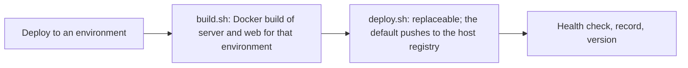

Work carried over from the trunk-based releases PRD, so it survives the merge. The PRD is [docs/20261012135301-prd-trunk-based-releases.md](docs/20261012135301-prd-trunk-based-releases.md); Simon set these items aside on 14-10-2026.

**Build PRD.** The release PRD keeps the build Docker-only; its scope is "the versioning and management of version and environments". The rest, in Simon's words, is "the scope of another [PRD] to then increase the scope of the build".

- **Replaceable build:** a swappable step, like `deploy.sh`, for Cordova, iOS, Android, Vercel, Cloudflare, Firebase.
- **Registry choice:** "an ECR or Docker Hub", or none: "going straight from the build to deploy".
- **Per-service images:** "we will need to do that at the service level", for monorepo microservices.
- **Build once where possible:** environment-free images, like the server, built once per version and reused.

**Already settled.**

- **Baked at build time:** "it needs to be a build time", because targets go beyond Docker.
- **Why:** "think of A, mobile app build, to B, edge deployment".
- **Tag shape open:** app, version and environment; or app and version when nothing is baked.
- **Related non-goal:** the release PRD keeps "one deployable app, one version".

**How it works today.**

- **Image refs:** `<registry>/<environment>/pimasi-web:<12-character SHA>`, plus `:<version>` when the environment tags.
- **Environment in the path:** the web image bakes `VITE_*` or `NEXT_PUBLIC_*` values.
- **Tags written once:** every deploy builds, and the path stops two builds sharing a tag.
- **Server bakes only `APP_VERSION` and `GIT_SHA`:** shareable once reuse means pulling, not rebuilding.
- **The push lives in `deploy.sh`:** the default, via `smoke-deploy.sh`, pushes to the host registry.

**Release follow-ups, from the Phase 5 review (15-10-2026).**

- **Role check before deploy:** "only maintainers can do a release"; on GitLab, protection stops only the writes, and on GitHub nothing.
- **Needs a live check first:** whether each host's default token may read the clicker's role.
- **`env remove`:** leaves `env/<name>` behind; `env add` overwrites a same-named branch.
- **Release-branch merge requests:** each gets a push and a merge request pipeline.
- **A release page whose tag is missing:** stays "publication incomplete", and a retry cannot fix it.
- **`env add` and `env remove` use `gh` or `glab`:** Simon dislikes both CLIs (15-10-2026); keep or drop?

**Other follow-ups.**

- **This npm package's releases:** its own PRD; "this repo is an npm package".
- **Release notes:** keep or drop "confirm on main"; name the versions production notes cover.
- **Live runs:** nothing has run on a real GitHub or GitLab project yet.
- **Publish the CLI:** apps adopt none of this until a new version is on npm.
