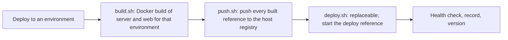

Work carried over from the trunk-based releases work, so it survives the merge. The release system is described in [docs/releases.md](docs/releases.md).

**Build PRD.** The release PRD keeps the build Docker-only; its scope is version and environment management. Expanding the build belongs in a separate PRD.

- **Replaceable build:** a swappable step, like `deploy.sh`, for Cordova, iOS, Android, Vercel, Cloudflare, Firebase.
- **Registry choice:** ECR or Docker Hub, or no registry when deploying directly from the build.
- **Per-service images:** images at the service level for monorepo microservices.
- **Build once where possible:** environment-free images, like the server, built once per version and reused.

**Already settled.**

- **Baked at build time:** environment values stay baked at build time, because targets go beyond Docker.
- **Why:** build targets can include mobile apps and edge deployments.
- **Tag shape open:** app, version and environment; or app and version when nothing is baked.
- **Related non-goal:** the release PRD keeps one deployable app and one version.

**How it works today.**

- **Image refs:** `<registry>/pimasi-web-<environment>:<12-character SHA>` and `<registry>/pimasi-server-<environment>:<12-character SHA>`, plus `:<version>` when the environment tags.
- **Environment in the image name:** the web image bakes `VITE_*` or `NEXT_PUBLIC_*` values.
- **Tags pushed again:** same-commit redeploys and rollbacks rebuild and push the same tags again; the environment suffix keeps environments apart. Write-once images belong to the deferred build-once item.
- **Server bakes only `APP_VERSION` and `GIT_SHA`:** shareable once reuse means pulling, not rebuilding.
- **The push lives in `push.sh`:** the pipeline pushes to the host registry before the deploy seam runs.

**Release follow-ups.**

- **Role check before deploy:** only Maintainers should be able to release; on GitLab, protection stops only the writes, and on GitHub nothing.
- **Needs a live check first:** whether each host's default token may read the clicker's role.
- **`env remove`:** leaves `env/<name>` behind; `env add` overwrites a same-named branch.
- **Release-branch merge requests:** each gets a push and a merge request pipeline.
- **A release page whose tag is missing:** stays "publication incomplete", and a retry cannot fix it.
- **Missed environment changelog entries:** the record advances before the page write, so a same-SHA redeploy skips a missed entry. The job artefact `env-page.md` allows manual recovery; whether to add an automatic replay path remains open. Retention and Maintainers-only `changelog/*` protection are specified in [docs/releases.md](docs/releases.md).
- **`env add` and `env remove` use `gh` or `glab`:** the release tooling otherwise avoids both CLIs; keep or drop their use here?
- **CLI test coverage:** nothing pins that `add` stays quiet with `--yes` or on a terminal.
- **Release shell tests in every app:** about 60 files ship and run in `make test` and the gate; keep them here only?

**Other follow-ups.**

- **This npm package's releases:** this repository is an npm package, and its releases need their own PRD.
- **Release notes:** keep or drop "confirm on main"; name the versions production notes cover.
- **Live runs:** nothing has run on a real GitHub or GitLab project yet.
- **Publish the CLI:** apps adopt none of this until a new version is on npm.
